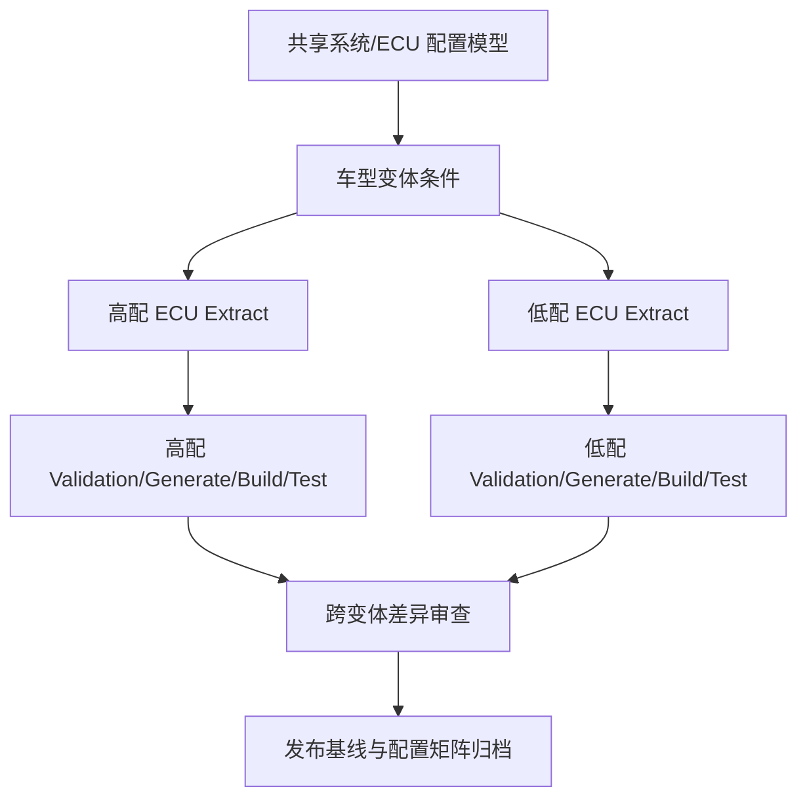

# 变体管理 Q1：一套 AUTOSAR 代码适配高配 / 低配车——怎么做到不维护两套配置？

原始 Flomo：https://v.flomoapp.com/mine/?memo_id=MjU0OTY4NzU2

变体管理 Q1：一套 AUTOSAR 代码适配高配 / 低配车——怎么做到不维护两套配置？

核心：不是维护两套配置，而是一套配置 \+ 变体条件（Variant Handling / Variant Point），按「当前激活的变体」解析出需要的部分。

三个关键概念：

1. 变体点（Variant Point）：配置里「可以变化」的元素——一个参数、一个 PDU、一个 SW-C、一个端口、一条连接。

2. 变体条件（Variant Condition）：用 VARIANT-VALUE 表达式描述「某元素在哪个变体下存在」。如「高配：存在 CAN FD 调度；低配：不存在」。

3. 变体（Variant）与变体集（Variant Set）：定义有哪些变体（高配 / 低配），以及每个元素的取值条件。

怎么用：

- ARXML 里用变体条件 + VARIANT-VALUE 标记可选性。
- 配置工具里为每个元素指定「适用变体」。
- 生成代码时按「当前激活的变体」把条件解析成最终配置——不同变体生成不同代码（或同一代码里用变体宏控制）。

所以一套代码 \+ 一套配置描述，靠变体条件区分高配 / 低配，不用复制成两套工程。（三种处理方式 PreCompile / Link / PostBuild 下一题展开。）

上一题：<https://v.flomoapp.com/mine/?memo_id=MjU0OTY4NjMw> 
总表：<https://v.flomoapp.com/mine/?memo_id=MjMxMTQ2NDk4>

#Area/技术/AUTOSAR

## 工程边界补充

“一套配置描述”不意味着所有高低配车型最终只生成同一份二进制或完全相同的 ARXML。通常可共享系统模型/配置模板，并通过 Variant Condition、System/ECU Extract 和工具链变体处理生成各车型的 ECU 级配置产物。变体表达式的合法范围、可变对象类型和选择阶段受 AUTOSAR Release 与工具支持约束。

建议用配置矩阵管理车型、硬件件号、软件版本、可选功能和变体条件，并在 CI 中对每个目标变体分别执行模型校验、生成、编译和测试，避免“高配能编译、低配缺引用”或相反的问题。

## 变体配置矩阵与 CI 验证

### 示例：高低配功能矩阵

| 功能/配置对象 | 高配车型 | 低配车型 | 验证点 |
|---|---|---|---|
| 前雷达 SWC | 启用 | 按项目需求禁用/替代 | SWC 实例与端口连接 |
| CAN FD PDU | 启用 | 传统 CAN 或不配置 | PDU/CanIf/控制器配置 |
| 高级诊断 DID | 启用 | 受控禁用 | Dcm/Dem 服务与权限 |
| NvM 参数块 | 可能增加 | 基础集合 | Block ID、长度、默认值 |
| OS Task/Runnable | 高算力任务集 | 精简任务集 | Task 映射、周期、栈和负载 |

表格只是说明变体管理方法，具体功能矩阵必须来自车型需求与系统设计，不能把示例当作任何 OEM 的真实高低配定义。

### CI 应分别构建每个目标变体

### 必须防止的错误

- 条件引用了不存在的 SWC/PDU/参数实例。
- 一个变体关闭了目标模块，却保留了其他模块对它的引用。
- 高低配使用不同内存/Task 资源，但仍复用不兼容的配置。
- 仅编译默认变体，未对每个实际量产变体执行构建和测试。
- PostBuild 变体虽能生成，但下载/刷写/启动时选择了错误配置集。

**结论：** 变体管理减少重复维护的是模型和配置来源；每个车型最终产物仍要独立验证，不能把“一套模型”理解为“只需编译一次”。
