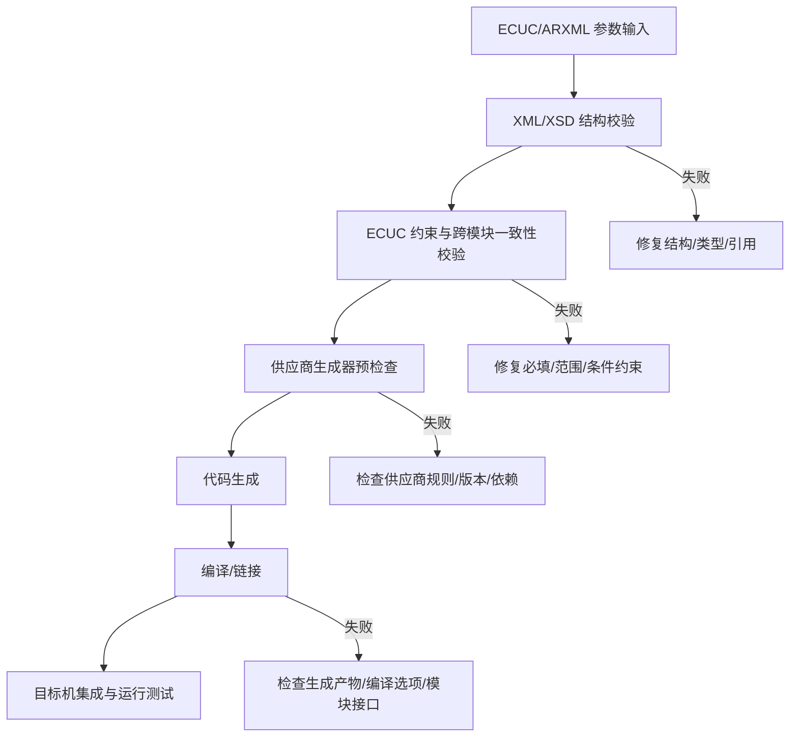

# 工具配置实战 Q1：新建 BSW 模块配置，哪些参数必填？填错了在哪一层报出来？

原始 Flomo：https://v.flomoapp.com/mine/?memo_id=MjU0NzcxNjE1

工具配置实战 Q1：新建 BSW 模块配置，哪些参数必填？填错了在哪一层报出来？

哪些算必填：

- 配置工具里参数分 required（必填）和 optional（可选），工具常用标记区分（必填项带星号 / 标红 / 列为 mandatory）。
- 必填的一般是模块能否正常工作的关键参数——如 CAN 的波特率、帧 ID、PDU 引用、模块实例关联。缺了这些，模块行为无法确定。

填错了在哪一层被发现（三层，按时间顺序）：

1. 配置 / 验证阶段：工具内的「验证」和 schema 校验先拦——必填没填、引用了不存在的模块实例、参数类型不合法，这个阶段直接报错，最快。

2. 生成代码阶段：配置工具把参数翻译成生成代码时做更严格检查——某个模块无有效值、生成器报错。这里能拦大部分「值合法但组合不对」的错。

3. 编译阶段：生成代码编不过——某个宏没定义、配置结构体缺字段。错误信息通常较隐晦，要回看配置定位，最费时间。

实际经验：大多数参数错误在第 1、2 层就被拦住。真正拖到编译器才报的，多是「值合理但组合/语义不对」的错，这种才难查——因为工具没拦、又不报具体参数。

判断某参数是否必填：看工具的必填标识 \+ schema（模块模板 / XSD）定义 + 生成器默认值。别光看界面，生成出的代码里缺了什么往往才是最诚实的答案。

上一题：<https://v.flomoapp.com/mine/?memo_id=MjU0NzcxNTU3> 
总表：<https://v.flomoapp.com/mine/?memo_id=MjMxMTQ2NDk4>

#Area/技术/AUTOSAR

## 必填项的规范判断与工程验收

### “必填”不是所有项目共用的一张清单

ECUC 配置参数是否必须提供，至少取决于：

- 模块定义中的参数定义类型、默认值和 multiplicity（例如容器是否允许 0..1、1、0..*）。
- 条件约束：某个参数可能只在特定功能开关、变体或引用目标启用时才成为必需。
- 模块间依赖：本模块参数可能要求其他模块实例存在并且配置一致。
- 供应商扩展：工具/BSW 厂商可能增加私有参数、默认值或额外校验规则。

因此，“CAN 波特率、PDU 引用必填”只能作为示例，不能当成所有 Can/CanIf 项目都一样的通用规则。应查对应 AUTOSAR Release 的 ECUC Module Definition、模块 SWS 和供应商配置手册。

### 配置错误会在哪一层暴露

### 实际排查步骤

1. 找到参数定义：确认范围、默认值、容器路径、引用目标类型和条件约束。
2. 确认变体：检查当前 ECU/车型/PreCompile、LinkTime、PostBuild 变体实际启用哪些功能。
3. 运行配置校验：保存 Validation Report，区分 error、warning 和供应商提示。
4. 运行生成：保存生成器版本、输入文件哈希、日志和产物清单。
5. 编译链接：确认 include path、宏、模块版本和生成文件是否来自同一基线。
6. 运行验证：对关键配置（周期、波特率、PDU 路由、诊断会话、NvM 块等）检查目标 ECU 行为。

**结论：** 判断必填项应以参数定义、当前变体和供应商规则为证；生成成功只说明生成器接受了输入，不代表系统需求和运行行为已经验证。
