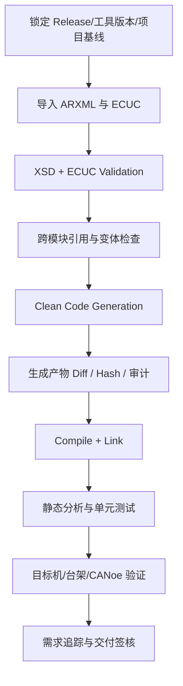

# 工具配置实战 Q2：怎么判断一个模块配置完整？Davinci 有没有「验证配置」功能？

原始 Flomo：https://v.flomoapp.com/mine/?memo_id=MjU0NzcxODcw

工具配置实战 Q2：怎么判断一个模块配置完整？Davinci 有没有「验证配置」功能？

判断完整性的四种手段（从软到硬）：

1. 工具验证 / 校验：Davinci 有 Check / Validate Configuration，EB tresos 是 Validation——做一致性检查（必填参数、跨模块引用、schema 合规），列出 error（红）和 warning（黄）。这是第一道、也最快的门。

2. 生成代码是否成功：生成器生成前会做一遍完整性与一致性预检——缺参数、引用断链会在生成阶段报错，这是最硬的「完整性」检验。能完整生成，说明配置结构已经自洽。

3. 引用完整性：跨模块引用（CanIf→Can 的 Controller、PduR→CanIf 的 PDU、Dcm→CanTp）——改完某模块要查被引用模块是否一致，用 Find Usage / 引用检查追。

4. 编译链接：生成代码能否编过、链接无 undefined reference。但它只反映值层面，语义/组合错误不报。

Davinci 的验证功能（具体）：Check Configuration / Validate、Dependencies 视图（看模块依赖是否建全）、Generate 前的预检查（mandatory params、复用引用）。

实用经验：

- 每次改完配置先跑 Validate，把 error 清了再生成，能省大量编译期排查。
- 生成报错不一定错在报错的模块——很多是「被引用模块」没配全，顺着引用关系往上追。
- 最常漏的两种：引用了但没建实例；建了实例但关键参数没配。

上一题：<https://v.flomoapp.com/mine/?memo_id=MjU0NzcxNjE1> 
总表：<https://v.flomoapp.com/mine/?memo_id=MjMxMTQ2NDk4>

#Area/技术/AUTOSAR

## 配置完整性验收矩阵

### 先区分四种“通过”

| 阶段 | 能证明什么 | 不能证明什么 |
|---|---|---|
| XML/XSD 校验 | 文件结构、元素/属性类型和 schema 约束基本正确 | ECUC 跨模块语义、运行时行为正确 |
| ECUC/供应商配置校验 | 必填参数、范围、引用和部分一致性规则通过 | 所有需求已实现、目标机时序正确 |
| 代码生成成功 | 当前工具接受配置并产生输出 | 生成代码一定满足需求或无生成器缺陷 |
| 编译/链接成功 | 代码接口、符号和编译条件基本一致 | ECU 运行状态、总线行为、诊断与掉电可靠性正确 |

### 建议的验收闭环

### 工具名称与版本边界

DaVinci Configurator、EB tresos 等工具通常提供配置校验、依赖/引用浏览和生成前检查，但菜单名称、校验范围和错误等级会随工具版本、模块包和供应商集成方式变化。不要把某个版本的 UI 文案写成 AUTOSAR 标准要求；以实际安装版本的帮助文档和 Validation Report 为准。

### CI 中建议保留的证据

- 输入：ARXML、ECUC、模块定义/XSD、变体描述、工具与插件版本。
- 校验：XSD 报告、ECUC Validation 报告、引用闭环报告。
- 生成：Clean Generation 日志、生成文件列表、文件哈希和语义 Diff。
- 构建：编译器版本、编译/链接日志、静态分析结果。
- 验证：目标机测试、CANoe Trace、诊断记录、NvM 掉电恢复报告。

**结论：** 配置完整性是从 schema 到目标机行为的多层证据，不是点一次 Validate 或看到 Generate Success 就算完成。
