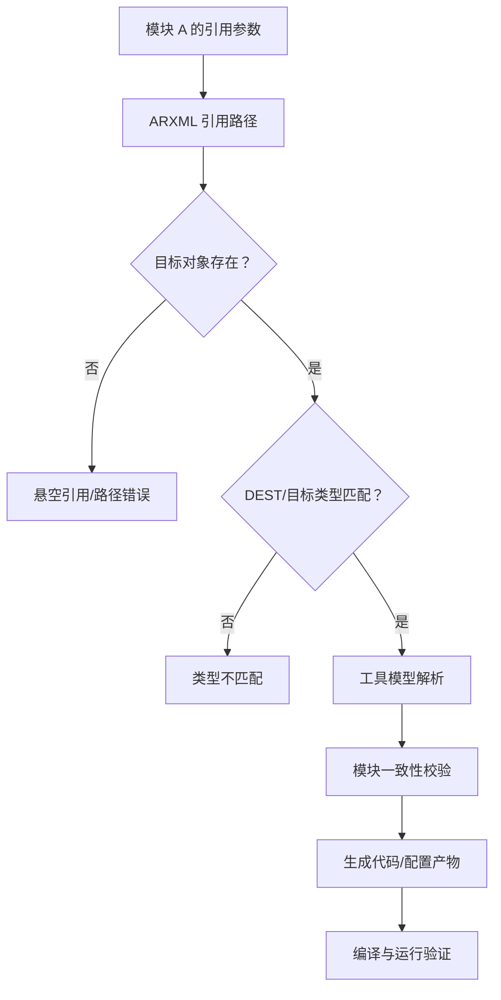

# 工具配置实战 Q3：Module 间的「引用」怎么建立？填模块名还是下拉列表？

原始 Flomo：https://v.flomoapp.com/mine/?memo_id=MjU0NzcyNjgw

工具配置实战 Q3：Module 间的「引用」怎么建立？填模块名还是下拉列表？

结论：不是手填模块名，而是通过下拉/浏览对话框选，选的是「强类型引用」，不是文本字符串。

为什么是下拉选择：

1. 引用通常是模型中的强类型对象引用：它有目标路径和目标类型约束，只允许指向符合该引用定义的配置对象。具体引用容器名称和目标类型应查对应模块的 ECUC 参数定义/XSD，不能用一个供应商工具中的字段名推断所有项目。

2. 工具提供浏览对话框：列出当前可用、且类型匹配的目标实例，让你点选。选中的底层存的是「指向该配置项的引用（ref）」，不是名字。

3. ARXML 层面体现为带 ref 的路径引用（REF / DEST 指向目标实例的路径），生成代码时解析成对应实体。

4. 一致性可追踪：对象被删/重命名，引用会失效或被打上断链标记，工具能发现（找 usage、断链检测）。反过来也能「谁引用了我」做影响分析。

什么时候需要手填：个别工具允许按路径手填，但推荐用下拉/浏览——手填无法强校验，且一旦目标改名就断链，难排查。

一句话：跨模块引用本质是「指向配置实例的强类型引用」，用下拉选而不是填名字，是保证类型安全、可追踪、可校验的关键。

上一题：<https://v.flomoapp.com/mine/?memo_id=MjU0NzcxODcw> 
总表：<https://v.flomoapp.com/mine/?memo_id=MjMxMTQ2NDk4>

#Area/技术/AUTOSAR

## ARXML 与配置工具中的引用如何核验

### 配置模型关系

### 实际检查顺序

1. **先查参数定义：** 在对应 AUTOSAR Release 的 ECUC Module Definition、模块 SWS 和供应商工具说明中确认该参数是 `ECUC-REFERENCE-DEF`、`ECUC-CHOICE-REFERENCE-DEF` 还是其他类型，核对 `DEST` 允许值和 multiplicity。
2. **再查 ARXML 实例：** 定位引用参数的 `DEFINITION-REF`、目标 `VALUE-REF`（或相应引用节点）和 `DEST`；检查目标路径是否存在、路径是否指向正确的 ECUC container。
3. **检查工具模型：** 刷新/重新导入依赖模块，确认引用浏览器显示的目标实例属于正确 ECU、变体和配置集；有些工具允许编辑 ARXML 路径文本，有些只提供浏览器，不要把 UI 操作方式当成 AUTOSAR 标准要求。
4. **执行一致性检查：** 分别检查 dangling reference、DEST 类型不匹配、目标对象重复/缺失、跨 ECU 引用和变体条件不一致。
5. **追踪生成结果：** 生成代码或配置头文件后，确认引用关系确实映射到预期模块实例；最终以构建日志、生成文件和目标机行为为证据。

### 常见错误与定位

| 现象 | 常见原因 | 检查点 |
|---|---|---|
| 下拉列表没有目标对象 | 目标模块未导入、目标容器未创建或过滤条件不匹配 | ECUC 模块定义、配置集、ECU/变体作用域 |
| ARXML 导入时报引用错误 | 路径错误、对象重命名或文件未一起导入 | `VALUE-REF` 路径、文件依赖、导入顺序 |
| DEST 类型不匹配 | 引用指向了错误类型的容器 | ECUC Reference Definition 的目标类型约束 |
| 工具里可见但生成失败 | 供应商校验规则、缺少其他依赖参数或版本不一致 | 工具版本、模块定义版本、validation report |
| 改名后大量模块失效 | 引用更新不完整或手工文本路径未同步 | Find Usages、全仓 ARXML Diff、引用完整性检查 |

### 工程验证建议

- 将 ARXML 按模块和 ECU 组织，提交时保证引用目标与引用者一起进入同一基线。
- CI 中增加 XML/XSD 校验、引用目标存在性检查、`DEST` 类型检查和语义 Diff；仅通过 XML 格式校验并不代表跨文件引用完整。
- 对关键引用保留“引用参数 → 目标容器 → 生成产物 → 运行时行为”的追踪记录。
- 不建议直接在生成代码中修补引用结果；应回到 ARXML/ECUC 配置和生成流程修复。
