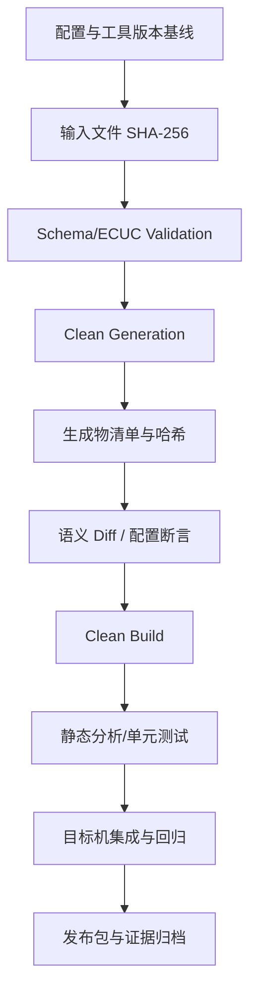

# AUTOSAR 1000问 · 工具链 Q1：如何保证工具链生成的代码就是自己配置的？

原始 Flomo：https://v.flomoapp.com/mine/?memo_id=MjU3Mzc2MjI1

**AUTOSAR 1000问 · 工具链 Q1：如何保证工具链生成的代码就是自己配置的？**

**费曼（一句话说清）**：工具链是翻译官——你把配置（ARXML）交给它，它吐出代码。真问题不是「它会不会骗你」，而是「你怎么让它说的每句话都可查证」。

**西蒙（抓核心）**：你证明不了生成器永远正确，但能让「配置→产物」变成可审计、可重放、有断言的确定性过程——把「信任工具」换成「审计过程」。

**SQ3R（带着问题读）**：先问「配置和产物之间，偏差可能出在哪几环」，答案锁定五层。

**麦肯锡金字塔（MECE 五层保险）**：

- 配置层：配置导出文本（ARXML/导出文件）入库，git diff 管变更
- 生成层：配置文件 hash 变化强制全量重生成，堵住「改了没重生成」
- 产物层：生成物入库，定期 clean build 后 diff，抓增量生成残留
- 断言层：CI 比对配置导出值与生成代码宏（Task 优先级/内存映射/DET/DEM 开关），不一致直接 fail
- 人工层：关键配置逐项勾评 \+ 工具链版本锁定，升级走评审

**卢曼卡片盒（互链）**：接入 1000问总表与上一题；后续可延伸「增量生成的坑」「ARXML 解析器行为」等题。

**坑**：生成日志 success ≠ 配置被忠实翻译（相关性≠因果）——没报错只代表没报错。

**一句话**：你审计的是过程，不是信任工具。

上一题：<https://v.flomoapp.com/mine/?memo_id=MjU1MjU1ODIy> 
总表：<https://v.flomoapp.com/mine/?memo_id=MjMxMTQ2NDk4>

#Area/技术/AUTOSAR

## 可审计的配置到代码流水线

### 建议固定的构建输入

- AUTOSAR Release、ECUC Module Definition、供应商 BSW 包和工具插件版本。
- ARXML/ECUC 配置、System Description、ECU Extract、变体条件和生成器参数。
- 编译器、链接器、编译选项、头文件和基础软件源码版本。
- 生成过程使用的环境变量、脚本版本和外部依赖。

### 审计流水线

### 哪些断言最有价值

- OS Task 周期/优先级/栈大小与配置基线一致。
- Runnable 到 Task 的映射、Event 周期和调用关系符合系统设计。
- COM/PduR/CanIf 的 PDU 路由、方向、周期和 ID 与通信矩阵一致。
- NvM Block ID、长度、CRC、冗余/数据集策略与存储设计一致。
- Memory Mapping、编译宏、分区和安全相关配置符合项目基线。

断言应从 ARXML/ECUC 解析得到预期值，再与生成头文件、配置结构体或 MAP 文件比较；不能用简单字符串搜索代替语义解析。

### 验收与限制

生成器可能有非确定性输出（时间戳、排序、路径等），因此应把“字节级完全相同”与“语义等价”分开。对生成器升级，保留旧版本/新版本 clean build 对照，先审查差异，再跑目标机回归。

**结论：** 可追溯性来自输入锁定、可重放生成、语义断言和目标机验证；生成日志 Success 只是流水线中的一个检查点，不是正确性证明。
