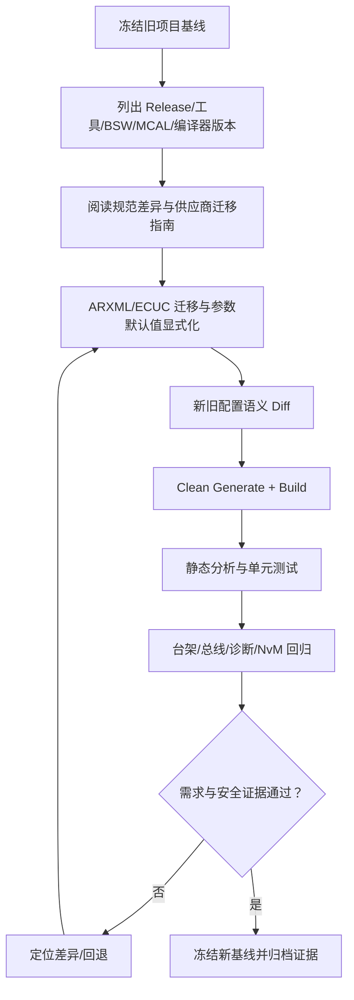

# 在项目上从哪个基线开始用？换基线最头疼的是规范改了还是工具改了？

原始 Flomo：https://v.flomoapp.com/mine/?memo_id=MjU0NzcxNTU3

在项目上从哪个基线开始用？换基线最头疼的是规范改了还是工具改了？

结合这几条我记过的判断：

- 工具链与工程化Q3（R20-11 → R21-11）：最头疼的不是生成代码行为变了，而是配置迁移里的隐性坑——参数默认值变了、某特性默认开/关改变、旧参数被移除或改名、工具迁过去但语义漂移。
- 项目实践Q1（Vector 换 EB）：换供应商最麻烦的是配置工具的差异（工具界面、配置模型、ARXML schema），不是生成代码行为。
- 专栏⑧第八篇：升级一个工具版本炸了三天——根子是默认值变了，不是代码逻辑。工具升级同时改了配置解读方式、生成模板、ARXML 规范版本。

统一判断：换基线 / 换版本，真正疼的是「工具 \+ 配置语义迁移」这条线，不是规范本身、也不是接口推倒重来。规范改了通常能被工具迁移兜住，但迁移中「默认值变 / 语义漂移 / 旧参数废弃」这种隐性变化最咬人——它们不报错，只在集成或运行时才暴露。

关于从哪个基线开始：从笔记看，项目落在 R4.x 这一代，日常在 R20-11 → R21-11 这个区间做升级，是经典平台当前的主流基线。（结合笔记的判断，第一个项目基线若另有不同可纠正。）

📎 工具链Q3：<https://v.flomoapp.com/mine/?memo_id=MjU0MTU3ODcx> 
📎 项目实践Q1：<https://v.flomoapp.com/mine/?memo_id=MjU0MjkwMDUx> 
📎 专栏⑧第8篇：<https://v.flomoapp.com/mine/?memo_id=MjQ5NTY2NDA4>

上一题：<https://v.flomoapp.com/mine/?memo_id=MjU0NzcxNDQ2> 
总表：<https://v.flomoapp.com/mine/?memo_id=MjMxMTQ2NDk4>

#Area/技术/AUTOSAR

## 如何选择项目基线与控制迁移风险

### 基线选择原则

不能仅凭“R20-11/R21-11 较新”或某个供应商工具支持就决定项目基线。应先满足 OEM/客户平台规范、车型 SOP 时间、芯片与 BSW 供应商支持、功能安全/网络安全要求和项目验证资源，再在可支持范围内选定 Release 与工具链组合。

| 维度 | 必须确认的证据 |
|---|---|
| OEM/平台约束 | 项目平台规范、接口基线、允许的 AUTOSAR Release |
| 芯片/MCAL | 芯片系列、MCAL 版本、编译器/链接器兼容矩阵 |
| BSW 供应商 | BSW 包版本、模块支持范围、已知限制和迁移说明 |
| 工具链 | DaVinci/EB/ARTOP 等工具版本、插件和许可证 |
| 系统架构 | Classic/Adaptive、OS、多核、通信与诊断配置 |
| 安全与合规 | ISO 26262、ISO/SAE 21434、OTA/更新约束及项目流程 |
| 量产维护 | 长期支持、缺陷修复、供应商维护周期和回滚能力 |

### 迁移风险不只来自“规范变更”

- **规范语义变化：** 参数/接口弃用、约束收紧、模块行为变化。
- **工具变化：** 配置模型、导入导出、验证规则和生成模板改变。
- **默认值变化：** 旧配置未显式设置的参数在新版本采用不同默认值。
- **供应商扩展变化：** 私有容器、回调、代码生成和集成脚本不兼容。
- **编译环境变化：** 编译器版本、ABI、警告等级和链接脚本变化。
- **运行时变化：** OS 调度、时序、内存占用、通信时序或诊断行为发生偏移。

### 推荐迁移步骤

**工程结论：** 你此前笔记中 R20-11→R21-11、Vector→EB 的经验说明“工具与配置语义迁移”可能是主要工作量，但这是具体项目经验，不是所有项目的普遍排序。应以新旧配置 Diff、生成产物、编译和目标机回归数据决定风险，而不是凭经验断言规范或工具哪一项一定最麻烦。
