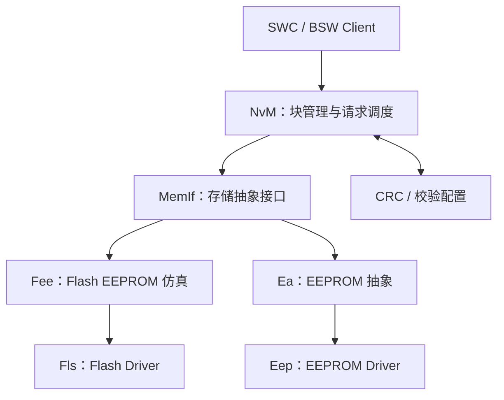

# NvM / MemIf / Fee / Ea 非易失存储实战

## 1. 模块职责与调用链

- **NvM**：管理逻辑块、默认值、读写请求、冗余/数据集块以及请求状态。
- **MemIf**：向上抽象不同存储设备，路由到 Fee 或 Ea。
- **Fee**：通常在 Flash 上实现 EEPROM 仿真，处理逻辑地址到物理 Flash 的映射与整理。
- **Ea**：提供 EEPROM 抽象。
- **Fls/Eep**：驱动底层存储硬件。

并非所有 ECU 都同时使用 Fee 与 Ea；实际链路取决于硬件与项目配置。

## 2. 同步与异步请求

NvM 的读写请求通常采用异步处理模型：API 返回“请求已接受/未接受”并不等于数据已完成写入。任务调度需要周期调用相关 MainFunction，之后再通过请求结果、回调或状态查询确认完成。不要在调用返回后立即假设 Flash 已经更新。

## 3. 关键问题

### 为什么 NvM 不直接操作 Flash？

NvM 面向逻辑数据块提供统一服务，屏蔽底层介质差异，并集中管理默认值、校验、冗余、请求队列和恢复策略。直接绕过 NvM 访问同一片存储区域可能破坏地址映射、数据一致性和故障恢复机制。

### Block、Block ID 与 RAM Block 是什么？

- **Block**：NvM 管理的逻辑存储单元。
- **Block ID**：标识对应逻辑块的配置 ID。
- **RAM Block**：运行时缓存/数据对象，读写请求会在配置的 RAM 与 NV 存储之间传递。
- **ROM Default**：配置的默认数据来源，在特定恢复路径中用于初始化数据。
- **管理类型**：Native、Redundant、Dataset 等类型影响数据组织与恢复策略，具体以标准版本和配置为准。

### CRC 有什么作用？

CRC 用于检测存储数据损坏，不提供防篡改的密码学保证。CRC 类型、覆盖范围和存储格式由配置决定。若要求抵抗恶意修改，需要另外设计认证与安全存储机制。

## 4. 上电恢复与掉电风险

典型上电流程会初始化底层存储模块，再通过 NvM 请求读取关键块；应用必须考虑读取尚未完成时的数据有效性。对于掉电中断的写入，Fee 的管理机制与 NvM 的配置共同决定恢复行为，不能假设所有数据块都具备原子事务保证。

建议为每类数据定义：
- 初始化默认值；
- 读取完成前的可用策略；
- CRC/校验失败后的处理；
- 写入频率与耐久性预算；
- 版本迁移策略；
- 关键参数失效时的安全降级行为。

## 5. 常见故障

### NvM_ReadBlock 返回成功，但数据仍不对

区分“请求被接受”与“最终结果成功”；检查 RAM Block 指针、Block ID、长度、CRC、ROM 默认值、初始化时序和读取结果状态。

### NvM_WriteBlock 后掉电，重启读到旧值

检查请求是否完成、MainFunction 是否持续执行、Fee/Fls 是否完成底层操作、写入结果是否成功、掉电时序以及是否读写了同一个 Block ID。必须通过断电注入测试验证，而不是只靠 API 返回值判断。

### 写入请求一直 pending

检查 NvM、MemIf、Fee/Ea、Fls/Eep 的 MainFunction 调度；确认底层驱动状态、作业队列、擦写错误、锁资源和回调链。逐层记录状态与时间戳。

### 数据频繁写入导致 Flash 磨损

评估实际写入频率、块大小、Fee 整理行为、底层 Flash 耐久性与冗余策略。可考虑合并更新、变化检测、延迟写入和合理的保存周期，但不得违反数据持久化和功能安全要求。

## 6. 调试证据链

1. 记录 NvM API、Block ID、指针与返回值。
2. 记录请求最终结果，而不只记录 API 返回。
3. 检查 NvM MainFunction 与底层 Fee/Ea/Fls/Eep 调度。
4. 检查 MemIf 作业状态和底层错误码。
5. 对照生成配置确认块管理类型、长度、CRC、默认值和存储设备映射。
6. 用掉电测试验证写入、恢复、CRC 错误和默认值恢复路径。

## 7. 测试清单

- [ ] 首次启动与默认值恢复
- [ ] 正常读写与非法 Block ID
- [ ] CRC 错误与数据损坏
- [ ] 请求排队与并发请求
- [ ] 写入过程中掉电与重启恢复
- [ ] 底层驱动错误和超时
- [ ] 高频写入与耐久性评估
- [ ] 软件升级后的数据版本兼容

## 8. 参考资料

- AUTOSAR 官方标准入口：https://www.autosar.org/standards
- 具体 API、块管理类型和恢复规则以项目采用的 NvM、MemIf、Fee/Ea 规范版本为准。
