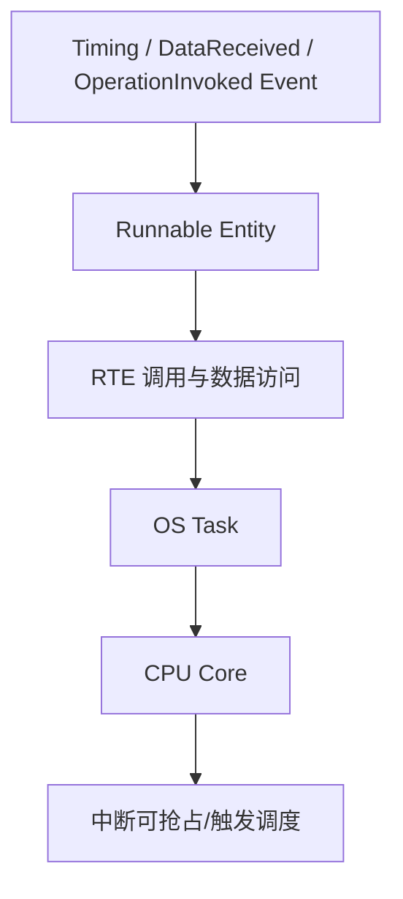

# OS 调度、多核与 Runnable 工程实战

## 1. 从 SWC 到 CPU 执行

Runnable 不是天然独立的 OS 任务。RTE 生成器会根据事件、任务映射、优先级和配置，把 Runnable 的执行安排到 OS Task 或相应调度上下文中。一个 Task 可以承载多个 Runnable，一个 Runnable 的映射与并发约束需由系统配置明确。

## 2. 常见调度概念

- **Task**：OS 调度的基本执行实体。
- **ISR**：中断服务例程，响应硬件或软件中断。
- **Priority**：影响就绪任务的调度顺序，但最终行为还取决于调度策略与资源占用。
- **Activation**：任务激活机制；激活限制配置错误可能造成激活失败。
- **Extended Task / Event**：支持等待事件的任务模型，具体取决于采用的 OS 规范与配置。
- **Resource / Spinlock**：用于保护共享资源或跨核访问，使用不当会引入阻塞和死锁风险。
- **Timing Protection**：用于约束执行时间、锁持有时间等运行时行为，是否启用取决于配置和实现。

## 3. 为什么 Runnable 没执行？

按证据顺序排查：
1. 对应 RTE Event 是否配置并连接到 Runnable。
2. Runnable 是否映射到预期 Task。
3. Task 是否被正确生成、激活与调度。
4. Task 是否被更高优先级任务持续抢占或阻塞。
5. 是否存在资源锁、Spinlock、等待事件或死锁。
6. 相关 BSW/RTE 初始化是否完成，通信模式是否允许事件触发。
7. 用运行时测量、OS Trace、断点或 GPIO 时间标记确认真实执行路径。

## 4. 周期任务的响应时间

周期任务的周期不等于实际响应时间。测量时应分开记录事件到达、任务就绪、任务开始执行、Runnable 开始/结束和输出生效的时间。延迟可能来自任务优先级、不可抢占区、锁等待、中断负载、缓存/总线竞争以及跨核同步。

## 5. 多核配置要点

- 明确每个 Task、ISR、Runnable 和 BSW 模块的核归属。
- 检查跨核数据传递与一致性机制，不要假设普通 C 变量自动具备跨核同步语义。
- 避免跨核锁顺序不一致导致死锁。
- 关注共享外设、中断归属、启动同步、核间通信和缓存一致性。
- 对时序关键链路做端到端测量，而不是只测单个 Runnable 的执行时间。

## 6. Exclusive Area 与互斥

Exclusive Area 是 RTE/应用模型中的互斥概念，实际实现可能映射到 OS Resource、Spinlock 或其他保护机制，取决于配置和平台。评审时应确认：
- 保护范围是否最小；
- 是否在持锁期间调用可能阻塞的接口；
- 不同调用路径的锁顺序是否一致；
- 是否存在 ISR 与 Task 共享数据的竞争；
- 保护机制是否与跨核访问相匹配。

## 7. 工程测试

- [ ] Runnable Event 到 Task 的映射可追踪
- [ ] 周期、最坏执行时间与响应时间有测量证据
- [ ] 高优先级负载下无不可接受的延迟
- [ ] 共享数据读写具有明确同步策略
- [ ] 多核启动、跨核通信和 Spinlock 有测试覆盖
- [ ] Timing Protection 或相应监控机制按项目要求配置
- [ ] 生成代码、OS 配置和 ARXML 版本一致

## 8. 版本提示

AUTOSAR OS、RTE 以及供应商扩展会影响具体 API、配置项和生成结构。本文说明的是通用工程概念，不应替代项目采用版本的规范和生成配置。
