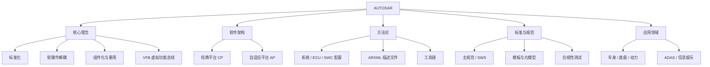

AUTOSAR（AUTomotive Open System ARchitecture，汽车开放系统架构）是由全球主要汽车厂商、零部件供应商与半导体公司联合制定的**汽车电子软件架构标准**。它的目标是让汽车软件标准化、可复用、可跨平台移植，是当今智能汽车软件开发的行业基石。

> [!info] 一句话定位
> AUTOSAR = 汽车软件的「操作系统级标准」：定义分层架构、组件模型、通信机制与开发流程，让不同厂商的软件能像积木一样拼装。

## 知识体系

## 子页面导航

- [[核心理念]] —— 标准化、软硬件解耦、组件化、VFB 虚拟功能总线
- [[软件架构]] —— 经典平台 CP 与自适应平台 AP 的分层设计
- [[方法论]] —— 系统配置、ECU 配置、SWC 配置与 ARXML 开发流程
- [[标准与规范]] —— 主规范、SWS、模板规范与合规性测试
- [[应用领域]] —— 车身、底盘、动力、ADAS、信息娱乐与车联网
- [[规范模块]] —— 规范模块库总索引：CP / AP / FO 三平台与 27 个核心模块笔记

## 1000问逐题解答

- [[1000问/OS调度与SWC工程补充]] —— OS 任务周期与优先级、栈/内存/时序保护，以及 Port Connector、RTE 生成验证的原始问答补充。

- [[1000问/基础架构通信与存储]] —— AUTOSAR 定义、分层、RTE、Runnable、配置生成、COM/PduR/CanIf、NvM/Fee。
- [[1000问/网络管理诊断存储与OS]] —— 唤醒源、EcuM/BswM、Bus-Sleep、DTC、Dcm 会话、安全访问、NvM 回调与掉电保护、OS 调度和功能安全。
- [[1000问/工具链平台安全与系统配置]] —— AUTOSAR 价值、配置生成审计、依赖追踪、Classic/Adaptive、WdgM、OS 可信分区、PreCompile/PostBuild、XCP/UDS 和 EcuM 启动序列。
- [[1000问/SWC_VFB_RTE与代码生成]] —— SW-C 类型、Composition、VFB、RTE S/R、Runnable 事件、RTE 生成代码、SchM、通信链路和 StbM 时间同步。
- [[1000问/Bootloader诊断模式管理与多核]] —— Partial Networking、Bootloader 跳转/回滚、UDS DID/0x19、BswM、OS Task、IOC、PDU/Port 排查。
- [[1000问/配置治理CDD与MemoryMapping]] —— 配置生成方法、学习路线、工具链治理、CDD、volatile、Schedule Table 和 MemMap。
- [[1000问/Bootloader刷写UDS与中断分类]] —— UDS 刷写链路、Dcm 到 SW-C、Session/SecurityAccess、ISR Cat1/2 与 BSW 服务分类。

~~~~mermaid
flowchart TD
  A[AUTOSAR 1000问] --> B[基础架构与 RTE]
  A --> C[通信与网络管理]
  A --> D[诊断与存储]
  A --> E[OS / 多核 / 安全]
  B --> F[逐题答案与工程验证]
  C --> F
  D --> F
  E --> F
~~~~

## MCAL 驱动配置

- [[MCAL/Dma]] —— DMA 通道与数据搬运配置。
- [[MCAL/Mpu]] —— 内存区域与访问权限保护。
- [[MCAL/Wdg]] —— 看门狗硬件驱动配置。
- [[MCAL/Eep]] —— EEPROM 驱动与异步读写。
- [[MCAL/Fls]] —— Flash 扇区、读写擦除与 Job 管理。
- [[MCAL/Lin]] —— LIN 通道、主从节点与帧调度。
- [[MCAL/CanTrcv]] —— CAN 收发器模式、唤醒与故障检测。
- [[MCAL/Can]] —— CAN 控制器驱动与收发配置。
- [[MCAL/Gpt]] —— 通用定时器通道与通知配置。
- [[MCAL/Pwm]] —— PWM 通道、周期与占空比配置。
- [[MCAL/Ocu]] —— 输出比较单元与输出控制。
- [[MCAL/Icu]] —— 输入捕获、边沿检测与时间测量。
- [[MCAL/Adc]] —— ADC 通道、组、触发与结果读取。
- [[MCAL/Dio]] —— 数字输入输出端口与通道控制。
- [[MCAL/Port]] —— 引脚方向、复用功能与电气属性。

- [[MCAL/index]] —— MCAL 模块总览与配置顺序（Mcu、Port、Dio、Adc、Icu、Ocu、Pwm、Gpt、Can、CanTrcv、Lin、Fls、Eep、Wdg、Mpu、Dma）。
- [[MCAL/Mcu]] —— MCU 时钟树、复位源、功耗模式与 RAM 初始化。

## 工程实践专题

概念与规范模块之外，以下专题把模型、生成代码和运行时故障串成可执行的工程流程：

~~~mermaid
flowchart LR
    A["SWC / Interface / ARXML"] --> B["System Description / ECU Mapping"]
    B --> C["RTE Contract 与代码生成"]
    C --> D["OS Task / Runnable 执行"]
    C --> E["COM → PduR → CanIf"]
    D --> F["集成测试与故障定位"]
    E --> F
~~~

- [[RTE 与 SWC 工程实现]] —— Port、Interface、Runnable、Event、Rte_Read / Rte_Write、Rte_Call 与任务映射。
- [[通信栈工程实战与 CANoe 验证]] —— 从 RTE、COM、PduR、CanIf 到 CAN 总线，附 CANoe Trace 分层验证与测试用例。
- [[COM 信号编码与发送接收机制]] —— 信号位布局、端序、Factor / Offset、发送接收控制、超时与测试向量。
- [[COM 配置参数与 ARXML 信号映射实战]] —— 从 ARXML 提取 I-Signal / I-PDU / Mapping，生成 CSV 审查报告并与 CANoe 测试向量交叉验证。
- [ARXML 信号审查脚本（Python）](https://github.com/ilikui/NotesBook/blob/main/scripts/arxml_signal_audit.py) —— 对多个 ARXML 文件做只读盘点、绝对引用匹配，输出 CSV / JSON，可用于 CI 前置检查。
- [[ARXML 与 RTE 代码生成实战]] —— ARXML 分层、引用校验、Contract Phase、RTE Generation、增量生成和版本追溯。
- [[AUTOSAR 故障排查手册]] —— Runnable 不执行、信号不更新、总线无报文、UDS / NvM 异常等分层排查。
- [[Classic平台学习路线与面试题]] —— 学习顺序、三条核心调用链、面试问答与工程化表达模板。

- [[诊断栈 Dcm Dem UDS 工程实战]] —— UDS 服务、NRC、P2/P2*、Dem/DTC 与诊断链路故障定位。
- [[NvM MemIf Fee Ea 非易失存储实战]] —— NvM 请求状态、存储抽象、掉电恢复、CRC 与 Flash 磨损。
- [[OS 调度 多核与 Runnable 实战]] —— Runnable/Event/Task 映射、实时性、多核同步与 Exclusive Area。
\n### 推荐阅读顺序

1. 建立全局认知：[[软件架构]] → [[核心理念]]。
2. 理解 SWC 模型：[[规范模块/SoftwareComponentTemplate]] → [[RTE 与 SWC 工程实现]]。
3. 理解生成输入与约束：[[规范模块/SystemTemplate]] → [[规范模块/ECUConfiguration]] → [[ARXML 与 RTE 代码生成实战]]。
4. 打通信号链路：[[通信栈工程实战与 CANoe 验证]] → [[规范模块/RTE]] → [[规范模块/COM]] → [[规范模块/PDURouter]] → [[规范模块/CANInterface]]。
5. 用真实现象验证：[[AUTOSAR 故障排查手册]]，最后完成 [[Classic平台学习路线与面试题]]。

> [!warning] 版本与供应商边界
> AUTOSAR Release、生成器版本、供应商扩展和项目配置会影响 API 签名、参数可用性、生成文件布局与诊断行为。示例用于理解机制，落地时应以项目实际生成头文件、配置和官方规范为准。

## 为什么值得学

- 汽车电子是目前嵌入式领域**最稳定、需求最大**的赛道之一；
- AUTOSAR 是主流车企与 Tier1 的通用语言，掌握它等于拿到入场券；
- 它把「实时控制（CP）」与「高算力智能（AP）」两种范式统一在一套标准下，技术视野宽阔。

## 相关

- [[新能源汽车]]
- [[RTOS]]
- [[MCU]]
- [[软件架构]]
- [[规范模块]]
