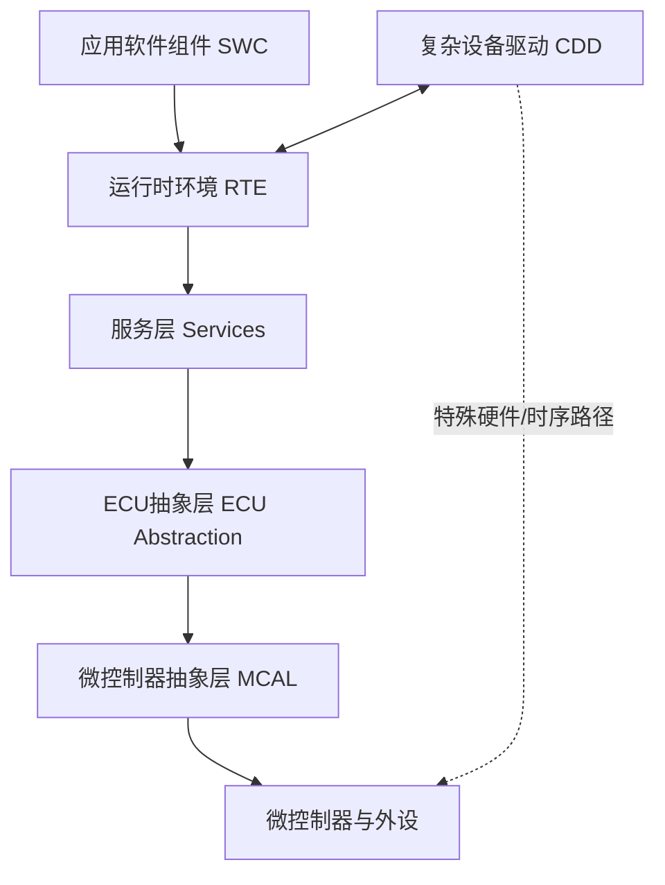

# AUTOSAR 基础资料、分层与历史卡片补充

本页收录此前散落在 Flomo 子标签中的基础资料、分层说明和规范阅读卡片。它们补充 AUTOSAR 1000 问主线，不替代规范模块专题。原文中存在的历史描述按原意保留；涉及标准边界的内容应以对应 AUTOSAR Release 的官方规范和项目配置为准。

## AUTOSAR Classic 分层关系

## BSW 服务分类与模块协作

BSW 服务层通常按系统服务、存储服务、通信服务、诊断服务、I/O 服务、安全相关服务等职责理解。具体模块归属和接口依赖要以所用 Release 的 BSW Module List、SWS 与项目配置为准。

## 规范文档阅读方法

阅读 AUTOSAR 文档时，先识别文档类型（如 SWS、RS、TPS、EXP、TR、CONC 等），再确认 Release、适用平台、术语和依赖规范；遇到配置参数时继续追踪容器定义、取值范围、默认值、约束和生成代码影响。

## DDS 与分布式通信

DDS 是以数据为中心的发布/订阅通信中间件标准，重点理解 Topic、DataWriter、DataReader、Domain、QoS、发现机制和可靠性策略。ROS 2 常用 DDS 实现作为通信底座；AUTOSAR Adaptive 与 DDS 的集成方式则应按具体平台和项目架构判断，不能简单等同。

## 来源卡片

### 1. 记录 BSW Com 层的逻辑

**Flomo 来源：** https://v.flomoapp.com/mine/?memo_id=MTA3NjQ1NDUw

**记录 BSW Com 层的逻辑**

关联自：<https://v.flomoapp.com/mine/?memo_id=ODQwNDI0MDg>

#Area/技术/AUTOSAR/BSW

---

### 2. 相关的学习链接 DDS（data distribution service，数据分发服务 ）简介-建模者 (uml.org.cn)

**Flomo 来源：** https://v.flomoapp.com/mine/?memo_id=ODM2MTkxMTA

相关的学习链接 DDS（data distribution service，数据分发服务 ）简介-建模者 (uml.org.cn)

<http://www.uml.org.cn/modeler/20201010112.asp>

<u><strong>什么是 DDS ？</strong></u>

工业物联网成熟的数据连接标准

数据分发服务（DDS™）是一个由对象管理组（OMG）发布的以数据为中心的中间件协议和 API 标准。DDS 集成系统中的各个组件，提供低延迟数据连接、高可靠性以及高可扩展体系结构，以适应商业级物联网（IoT）应用程序的需求。

在分布式系统中，中间件是位于操作系统和应用程序之间的软件层。它使系统的各个组件能够更轻松地通信和共享数据。它简化了分布式系统的开发，让软件开发人员专注于其应用程序的特定用途，而不是在应用程序和系统之间传递信息的机制。

DDS 中间件是一个软件层，它将应用程序从操作系统，网络传输和低级数据格式的详细信息中抽象出来。以不同的编程语言提供了相同的概念和 API，从而允许应用程序跨操作系统，语言和处理器体系结构交换信息。底层细节，如数据线格式、发现、连接、可靠性、协议、传输选择、QoS、安全性等都由中间件管理。

**备注**

相关的补充

- <https://design.ros2.org/articles/ros_on_dds.html>

#Area/技术/AUTOSAR/DDS

---

### 3. AUTOSAR通用的文档阅读技巧

**Flomo 来源：** https://v.flomoapp.com/mine/?memo_id=OTIxMjIzNjk

AUTOSAR通用的文档阅读技巧

- 熟悉文档的相关的简单的缩写

  - Autosar信息类别

    - <mark>ASWS</mark> Abstract SWS Software Specification

    - <mark>ATR </mark> Acceptance Test Requirement

    - <mark>ATS</mark> Acceptance Test Specification

    - <mark>CONC</mark> Concept Document

    - <mark>CTCF</mark> Configuration Settings

    - <mark>CTSP </mark> Conformance Test Specification

    - <mark>EXP</mark> Explanation

    - <mark>NMOD</mark> MetaModel

    - <mark>MOD </mark> Model

    - PD Process Description

    - PDEP Profile of Data Exchange Point

    - PRS Protocol Specification

    - RS Requirement Specification

    - SWS Software Requirement Specification

    - TMPL Template

    - TPS Template Specification

    - TR Technical Report

    - UC Use Case Specification

    - ZAUX Auxilary material

    - ZGEN Generated intermediate material

    - ZSUPP Supplemental material

#Area/技术/AUTOSAR/General

---

### 4. 

**Flomo 来源：** https://v.flomoapp.com/mine/?memo_id=ODQwNDIyMjU

- RTE 层

💡<u>RTE 是 AUTOSAR 实现“应用与硬件解耦”的核心机制。它将每个软件组件包装成独立单元，自动处理组件之间的通信和调度，从而让应用开发者只需关注业务逻辑，而不用关心底层通信、操作系统和 ECU 分布</u> **。**

📚更多的数据记录在Notion里面的卡片笔记

#Area/技术/AUTOSAR/Layers

---

### 5. - 服务层

**Flomo 来源：** https://v.flomoapp.com/mine/?memo_id=ODQwNDIxMTk

- 服务层

  - 操作系统功能 Ø

  - 车辆网络通信和管理服务 Ø

  - 内存服务（NVRAM管理）

  - 诊断服务（包括UDS通信、错误存储和故障处理）

  - ECU状态管理、模式管理

  - 逻辑和逻辑

#Area/技术/AUTOSAR/Layers

---

### 6. - 复杂驱动层

**Flomo 来源：** https://v.flomoapp.com/mine/?memo_id=ODQwMjQwMjg

- 复杂驱动层

  - 任务 提供集成特殊用途功能的可能性，例如设备驱动程序：

    - Ø 未在 AUTOSAR 中指定，

    - Ø 具有非常高的时序约束，

    - 或 Ø 用于迁移目的等。

**🧩 1\. 西蒙学习法：拆解 CDD 实现过程**

西蒙学习法的核心是 **“把复杂知识切成小单位，集中火力一次处理一块”**。实现一个 AUTOSAR 复杂驱动层，可以精准拆解为以下 **4个核心微模块**：

**📦 微模块 A：架构定义与接口设计 (SWC-CDD 契约)**

- **目标**：解决 CDD 与上层应用软件组件（SWC）以及运行时环境（RTE）的通信问题。

- **动作**：在 AUTOSAR 配置工具中创建 CDD 类型的软件组件。定义其 **Ports (端口)**、 **Interfaces (接口)** 以及 **Runnable Entities (可运行实体)**，并将其与 RTE 绑定。

**🏎️ 微模块 B：硬件资源分配与 BSW 关联**

- **目标**：解决 CDD 如何合法、不冲突地拿到硬件控制权。

- **动作**：通过 BSW (基础软件) 基础配置，为 CDD 分配专用的硬件资源（如特定的 Timer、PWM 通道、SPI 通道或 MCU 专属引脚），确保这些资源在标准 MCAL (微控制器抽象层) 中被排除，防止寄存器冲突。

**⚙️ 微模块 C：内核代码编写与寄存器控制**

- **目标**：实现 CDD 的物理控制逻辑。

- **动作**：直接或通过 MCAL 提供的未开放接口，编写针对特定微控制器（MCU）的底层 C 代码。包括初始化函数 CDD\_Init()、周期性执行函数（如发动机点火时序控制）以及中断服务程序（ISR）。

**🔗 微模块 D：集成与 RTE 粘合代码生成**

- **目标**：将手写代码融入标准化流水线。

- **动作**：通过工具链生成包含 RTE 粘合层代码的头文件。在手写 C 文件中包含 Rte\_CDD.h，实现类似 Rte\_Read\_XXX() 或 Rte\_Call\_XXX() 的接口，将底层采集的急迫数据或高频信号直接泵送给上层。

**💡 2\. 费曼技巧：用大白话理解 CDD 的本质**

**费曼式比喻：** 想象 AUTOSAR 是一个规矩极度严格的 **高档现代工厂**。

- **上层应用（SWC）** 是坐在办公室的 **产品经理**，只提需求，不碰机器；

- **标准基础软件（BSW/MCAL）** 是工厂里的 **通用流水线**，按部就班，效率稳定但动作死板。

突然，工厂引进了台 **极其特殊的超高速激光雕刻机（非标高频硬件）**，经理要求它必须在 **1毫秒内** 对突发情况做出反应。如果走普通的申报流程（通过标准 BSW 层层上报给 RTE，再下发指令），工厂早就着火了。

于是，工厂破例开辟了一条 **“绿色特殊VIP通道”**，并招聘了一位 **特遣专员**。这个专员 **左手牵着经理的办公桌（连接 RTE）**， **右手直接按着激光雕刻机的电闸（直接操控硬件寄存器）**。这个特遣专员，就是 **CDD (复杂设备驱动)**。

**为什么一定要有 CDD？（用费曼自问自答查漏补缺）**

1. **问**：既然有了标准 MCAL，为什么不能直接用？ **答**：MCAL 是大众情人。对于极端的、非标的硬件协议（比如某些特殊的超声波雷达、复杂的电机控频、功能安全要求极高的点火控制），标准库根本没有定义对应的 API。

2. **问**：CDD 既然可以直接操作硬件，它跟传统裸机驱动有什么区别？ **答**：它有双重身份。它虽然底层像裸机驱动一样直接调寄存器，但它的上层必须穿上“正装”——即通过标准的 AUTOSAR 描述文件 (ARXML) 生成契约接口。对于应用层来说，它看起来就像一个标准的模块，从而保证了系统整体的套路不被破坏。

#Area/技术/AUTOSAR/Layers

---

### 7. - 应用层

**Flomo 来源：** https://v.flomoapp.com/mine/?memo_id=ODQwMjMzMzE

- 应用层

- 运行时

- 服务层

- 抽象层

  - <https://v.flomoapp.com/mine/?memo_id=ODQwMjI5MjM>
- 驱动层

- 微控制器

#Area/技术/AUTOSAR/Layers

---

### 8. - ECU抽象层

**Flomo 来源：** https://v.flomoapp.com/mine/?memo_id=ODQwMjI5MjM

- ECU抽象层

  - ECU 抽象层连接微控制器抽象层的驱动程序。它还包含外部设备的驱动程序。它提供了一个 API，用于访问外设和设备，无论其位置如何（μC 内部/外部）以及它们与 μC 的连接（端口引脚、接口类型）参考图片 <https://static.flomoapp.com/file/tmp/2023-09-25/325536/3121e106396c355c81051c7843691394.png/thumbnailwebp?OSSAccessKeyId=LTAI4G9PcaGksWVKCPrE1TVL&Expires=1695870045&Signature=Xi6zgC4pphW%2BFi5yFdozxjaFk9U%3D>

#Area/技术/AUTOSAR/Layers

---

### 9. - 微控制器抽象层

**Flomo 来源：** https://v.flomoapp.com/mine/?memo_id=ODQwMjI3NzI

- 微控制器抽象层

  - 基础软件的最底层软件层。它包含内部驱动程序，这些驱动程序是可直接访问 μC 和内部外设的软件模块。参见 <https://static.flomoapp.com/file/tmp/2023-09-25/325536/bdf7e766d5e7fd71139bd132577131ec.png/thumbnailwebp?OSSAccessKeyId=LTAI4G9PcaGksWVKCPrE1TVL&Expires=1695869960&Signature=9IltLN9LHeKhK0XkAKXBdHTn5nc%3D>

    

    #Area/技术/AUTOSAR/Layers

---

### 10. 【参考文档】Specification of RTE Software.pdf

**Flomo 来源：** https://v.flomoapp.com/mine/?memo_id=ODMyNjI4NzU

【参考文档】Specification of RTE Software.pdf

The following list is a collection of proposed information items in particular applicable to log files used for exchanging information about errors.

- <mark>ErrorCode  </mark>\- A symbolic name for the message text

- <mark>StandardErrorCode </mark>-The reference to the AUTOSAR error code

- <mark>ConstraintCode </mark>– Reference to the semantic constraint mentioned in the AUTOSAR template specification.

- ConstraintCode – Reference to the semantic constraint mentioned in the AUTOSAR template specification.

- Signature – Signature of the message for duplicate checks

- Timestamp – A time stamp for the message

- ShortName – A unique identification which allows to refer to particular error messages This can also be used to establish references between error messages, e.g. for screening and also to trace back to root cause

#Area/技术/AUTOSAR/RTE

#Archive/MigratedNotion 
#Archive/DeleteCandidate

## Mentor 旧版 AUTOSAR 培训资料

以下是早期 Mentor 培训资料的目录与主题摘录，保留作为历史学习线索。由于版本较早，实际工程使用时需对照当前 AUTOSAR Release 与供应商工具版本。

### 1. - 系统调试(System debugging)

**Flomo 来源：** https://v.flomoapp.com/mine/?memo_id=MTAyNDY2MzM3

- 系统调试(System debugging)
  - DET(Development Error Tracer)

  - DEM

  - VFB Tracing

  - DLT(AUTOSAR 4.0)
- Migration strategies

- Integration strategies

- Handling legacy file formats

- Resource consumption

#Resource/工具/Mentor

#Archive/MigratedNotion 
#Archive/DeleteCandidate

---

### 2. 

**Flomo 来源：** https://v.flomoapp.com/mine/?memo_id=MTAyNDY2MDg1

01. Introduction

02. Architecture

03. Methodology

04. Application interfaces

05. AUTOSAR 3.2 and 4.0

06. AUTOSAR 4.0.x

07. AUTOSAR toolchain

08. SWC layer

09. SWC internals and RTE

10. SWC internals Continued

11. BSW Internals and services

12. Diagnostics

13. AUTOSAR in practice

    [https://v.flomoapp.com/mine/?memo\_id=MTAyNDY2MTY4](https://v.flomoapp.com/mine/?memo_id=MTAyNDY2MTY4)

#Resource/工具/Mentor

#Archive/MigratedNotion 
#Archive/DeleteCandidate
