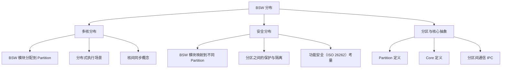
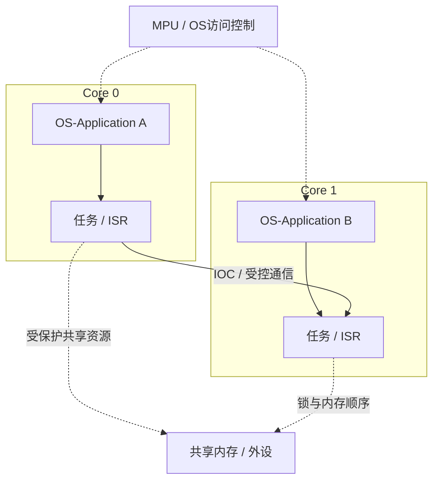

`BSWDistributionGuide` 是 CP 解释性指南（EXP），讲清一个核心问题：**基础软件（BSW）如何分布到多核 CPU 的不同分区（Partition）上**，以及在功能安全场景下如何做分区隔离与内存保护。它分两部分：多核分布与安全分布。

> [!info] 一句话定位
> 学 CP 的**第一站**：先理解「BSW 怎么摆到多核 / 分区分核」，后面所有模块的部署都以它为背景。

## 规范信息

| 项目 | 内容 |
| --- | --- |
| 平台 | CP |
| 类别 | EXP — 解释性指南（Explanation） |
| UID | 631 |
| 版本 | R25-11 |
| 本地 PDF | `AUTOSAR_CP_EXP_BSWDistributionGuide.pdf` |
| 纯文本全文 | `CP_EXP_BSWDistributionGuide.complete.txt` |

## 知识体系

## 核心要点

- **为什么分布**：把 BSW 模块分配到不同分区 / 核心，可同时提升**功能安全**（隔离故障域）与**性能**（并行执行）。自 R4.1 起支持在**多核系统**上分配 BSW 到分区；自 R4.2 起支持在**安全场景**下把 BSW 映射到不同分区并相互保护。
- **支持的场景**：文档给出多种「BSW 在多个分区与核心上分布式执行」的场景，以及能提升性能的典型用例。
- **同步与通信**：引入适用于分布式 BSW 执行的基础同步概念，以及**分区间通信（Inter-Partition Communication）**的入门。
- **上层依赖**：分区的定义依赖虚拟模块 `EcuC`，OS 与 RTE 通过 **IOC** 跨分区传数据。

## 依赖关系

- 与 [[OS]]（OS-Application / 分区保护）、[[RTE]]（IOC 跨分区通信）、`EcuC`（分区与核心定义）紧密相关。
- 是理解 [[ECUStateManager]] 多核 STARTUP/SHUTDOWN 协调的背景知识。

## 相关

- [[ModeManagementGuide]]
- [[RTE]]
- [[OS]]
- [[CP]]
- [[规范模块]]

---

# 工程问答补全：BSW 多核与分区部署

以下说明用于理解 Classic Platform 的分区设计。具体可用机制取决于 AUTOSAR Release、OS 实现、MCU 多核能力、供应商集成方式及项目安全目标；不能仅凭概念图推断某个模块天然支持跨核运行。

## Q1. Core、OS-Application、Partition 和 ECU 是什么关系？

**答案：** ECU 是整车电子控制单元；Core 是处理器执行核心；OS-Application 是 AUTOSAR OS 中承载任务、ISR、Alarm、Schedule Table 等对象并定义访问权限的保护/调度实体；Partition 常用于描述模块部署与隔离边界。Core 是硬件执行资源，OS-Application/Partition 是软件隔离与资源组织概念，两者不是同义词。

## Q2. 为什么不能简单地把 BSW 模块平均分到多个核？

**答案：** 多核分配需要考虑模块依赖、调用方向、任务优先级、数据所有权、中断亲和性、通信延迟、锁竞争、启动顺序和安全隔离。平均分配可能增加跨核通信与同步开销，反而降低性能并增加死锁风险。应先绘制依赖图和数据流，再以实时性、故障隔离和可验证性为目标分配。

## Q3. BSW 模块跨 Partition 通信为什么常涉及 IOC？

**答案：** 当运行在不同 OS-Application/分区中的任务需要交换数据时，不能假设它们可以像同一地址空间中的普通函数一样直接访问彼此对象。IOC（Inter-OS-Application Communication）提供受配置和 OS 约束的分区间通信机制。具体数据复制、队列/非队列语义、同步方式和可用调用上下文依赖 OS 配置及实现。

## Q4. 什么场景需要跨核同步？Spinlock 和普通 Mutex 有何差异？

**答案：** 多核任务访问共享资源、共享状态或硬件外设时，需要明确互斥与可见性。Spinlock 通常通过忙等方式等待锁释放，适用于极短临界区且不能睡眠/阻塞的受限场景；Mutex 通常允许等待者阻塞，并可配合优先级继承等策略（取决于 OS）。两者都必须遵守锁顺序、超时和中断上下文限制。不要在持锁期间执行长时间 I/O 或不可预测函数。

## Q5. 多核分区怎样实现内存保护？

**答案：** 通过 MPU/MMU（取决于 MCU/平台）配置任务/分区可访问的代码、数据和外设区域，并配合 OS 的访问控制与错误处理，限制越权访问。需要同时审查栈、全局数据、共享内存、DMA 缓冲区和外设寄存器；DMA 访问不一定受 CPU 的同一套内存保护规则约束。

## Q6. 安全分区是否等于功能安全已经实现？

**答案：** 不等于。分区隔离是减少干扰和限制故障传播的机制之一，但功能安全还需要安全需求分解、独立性论证、Freedom from Interference 分析、时序/资源预算、故障检测与安全状态、工具链可信度、验证证据和安全案例。物理上不同分区不自动意味着满足 ISO 26262 的独立性要求。

## Q7. 怎样决定模块放在哪个 Core？

**答案：** 先根据任务周期、截止时间、WCET、中断负载和资源需求建立负载模型；再分析模块调用图与共享数据；将强耦合、频繁交互模块尽量放在同一执行域，减少跨核调用；最后验证负载均衡、最坏响应时间、锁竞争、通信开销和故障隔离。分配决策必须由测量和分析支撑，而不是只看平均 CPU 利用率。

## Q8. 跨核共享变量加 volatile 就安全吗？

**答案：** 不安全。volatile 主要约束编译器对特定访问的优化，不提供原子性、互斥、跨核同步或完整的内存顺序保证。需要根据处理器和编译器使用原子操作、OS 同步原语、锁、临界区及必要的内存屏障；同时考虑 Cache 一致性和 DMA 一致性。共享数据最好明确单一写者、所有权转移和一致性协议。

## Q9. 多核启动和关机顺序怎样设计？

**答案：** 定义主核/从核启动责任、OS 启动屏障、共享内存初始化者、跨核通信可用时刻、模块初始化依赖和故障回退。关机时先停止新请求，再通知其他核退出业务、停止周期任务/中断源、完成必要的数据持久化，最后释放共享资源。任何等待其他核的步骤都必须有超时与失效策略，避免一个核异常导致整车 ECU 永久卡住。

## Q10. 多核系统如何定位偶发数据错乱和时序问题？

**答案：** 同步采集各核时间戳、任务/ISR 运行轨迹、锁获取/释放、IOC 队列状态、共享数据版本号和异常上下文。检查数据竞争、错误的内存顺序、锁顺序反转、Cache/DMA 一致性、跨核中断延迟和负载峰值。通过压力测试、故障注入和可重复的最小用例确认根因。

## 多核部署与数据流

## 部署评审清单

- [ ] 模块调用图、任务映射和数据所有权已定义。
- [ ] 每个跨分区数据通路都明确 IOC/共享内存策略。
- [ ] 锁顺序、临界区上限、优先级反转和中断约束已评审。
- [ ] MPU/内存区域、栈、DMA 缓冲区与外设访问已检查。
- [ ] 多核初始化、同步启动、异常核退出和关机路径已验证。
- [ ] 已完成最坏响应时间、资源预算和负载峰值分析。
- [ ] 安全隔离论证包含 Freedom from Interference 与验证证据。
