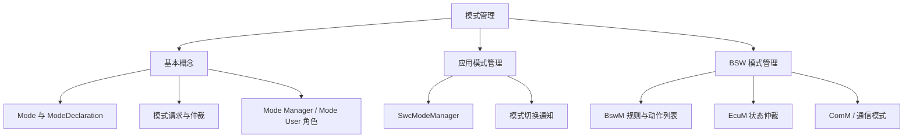
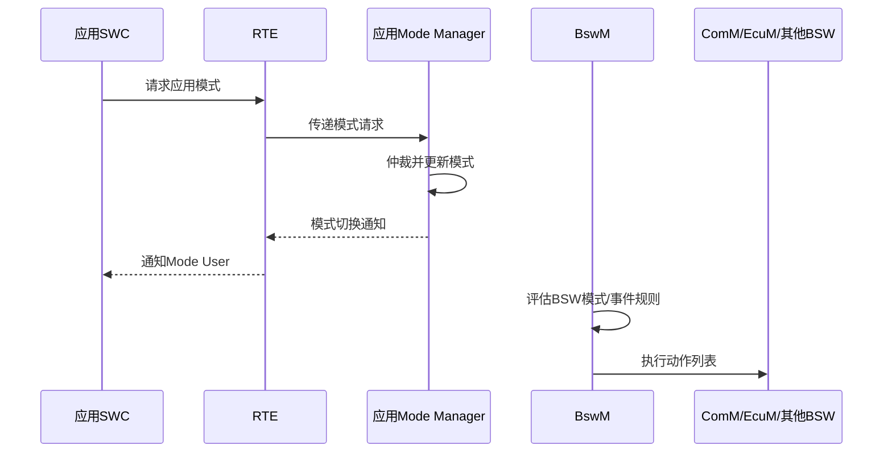
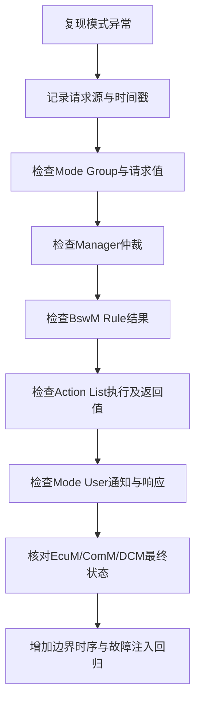

`ModeManagementGuide` 是 CP 解释性指南（EXP），系统讲解 AUTOSAR **模式管理（Mode Management）**：模式是什么、模式切换如何实现、模式管理器（Mode Manager）与模式使用者（Mode User）各自的角色，以及应用模式管理（Application Mode）与基础软件模式管理（BSW Mode）之间的关系。

> [!info] 一句话定位
> CP 里「谁在什么条件下切到什么状态」的统一答案，BswM 是其中的中枢。

## 规范信息

| 项目 | 内容 |
| --- | --- |
| 平台 | CP |
| 类别 | EXP — 解释性指南（Explanation） |
| UID | 440 |
| 版本 | R25-11 |
| 本地 PDF | `AUTOSAR_CP_EXP_ModeManagementGuide.pdf` |
| 纯文本全文 | `CP_EXP_ModeManagementGuide.complete.txt` |

## 知识体系

## 核心要点

- **基本概念**：模式（Mode）是系统状态的一种抽象；模式切换通过模式管理器下发、模式使用者响应；文档用一套示例 ECU 的代码配置串讲全流程。
- **应用与 BSW 的联动**：应用模式管理（Application Mode）与基础软件模式管理紧密相关，应用侧的模式请求会驱动 BSW 侧动作。
- **BswM 是中枢**：BSW Mode Manager 是 R4.0 起的核心模式管理模块，可高度配置——用**规则（Rule）**评估条件、用**动作列表（Action List）**执行结果，配置方法是本指南的重点。
- **工程边界**：网关 ECU、多网络通信管理、诊断路由和多核协同需要按各网络状态管理器、Dcm 配置及 OS/RTE 跨核机制分别设计；本文后续工程问答给出通用分析框架，具体容器与 API 以项目 Release 和供应商实现为准。

## 依赖关系

- 依赖 [[BSWModeManager]]（BswM，规则与动作）、[[ECUStateManager]]（EcuM，状态仲裁）、[[COMManager]]（ComM，通信模式）。
- 应用侧模式经 [[RTE]] 传递。

## 相关

- [[BSWDistributionGuide]]
- [[BSWModeManager]]
- [[ECUStateManager]]
- [[COMManager]]
- [[CP]]
- [[规范模块]]

---

# 工程问答补全：模式管理如何落到 ECU 项目

以下按 Classic Platform 的典型架构解释。具体 API、容器、模式组、通知机制与可用功能以项目所采用的 AUTOSAR Release、模块 SWS 和供应商实现为准。

## Q1. Mode、ModeDeclaration、ModeDeclarationGroup 和 ModeRequestType 分别是什么？

**答案：** Mode 是系统或组件可处于的一种离散状态，例如 STARTUP、RUN、POST_RUN、SLEEP。ModeDeclaration 是模型中声明的具体模式；多个相关模式通常组织在 ModeDeclarationGroup 中；模式请求则表达某个参与者希望系统或模式组进入某个状态。不要把“模式声明”“模式请求”和“模式切换完成通知”混为一谈。

工程上要同时检查：
- 模式组允许的模式集合及初始模式；
- 请求者是否具有请求权限，是否存在冲突请求；
- 模式管理器如何仲裁多个请求；
- 使用者何时收到切换通知，以及何时完成本地动作。

## Q2. Mode Manager 和 Mode User 的职责如何划分？

**答案：** Mode Manager 负责接收请求、执行策略/仲裁并发布当前模式；Mode User 订阅或接收模式变化，并据此启停功能、改变通信行为或调整资源状态。一个 ECU 中可以存在多个不同范围的模式管理者，不应默认所有模式都由单个 BswM 统一控制。

## Q3. Application Mode 与 BSW Mode 有什么区别？

**答案：** Application Mode 面向应用功能行为，例如舒适模式、驾驶模式或功能启用状态；BSW Mode 面向基础软件服务状态，例如通信允许、网络唤醒、诊断会话或 ECU 启停阶段。两者可通过 RTE 模式接口、BSW 模式通知及项目定义的协调逻辑关联，但语义和责任边界不同。

**典型链路：**

此图表示一种常见协作关系，不意味着所有项目都必须采用 SWC 直接触发 BswM 的单一路径。

## Q4. BswM Rule、Logical Expression 和 Action List 如何协作？

**答案：** BswM 将模式请求、状态变化或其他配置输入映射为规则评估；规则中的逻辑表达式判断条件是否满足；规则结果触发配置的动作列表。动作列表可执行模式切换相关的 BSW 服务调用，具体动作类型和执行限制依赖所用规范版本及实现。

设计时应明确：
1. 输入信号来自哪个模块、何时更新；
2. 规则是周期评估还是事件触发；
3. 多条规则同时成立时的优先级和仲裁；
4. Action List 的执行顺序、可重入性与错误处理；
5. 是否存在动作反向触发原规则的循环；
6. 初始化阶段输入尚未有效时采用什么默认策略。

## Q5. EcuM、BswM、ComM 在启动、运行和休眠时如何配合？

**答案：** EcuM 管理 ECU 生命周期和唤醒/关机流程；BswM 根据模式和请求执行配置的 BSW 协调动作；ComM 管理通信通道的通信模式请求与限制。常见流程是唤醒源触发启动，EcuM 推进初始化状态，BswM 协调通信及其他服务，ComM 根据用户请求和总线策略管理通信；关机时则先完成用户释放、通信降级、存储写入和关机条件检查，再进入低功耗状态。

不要把 EcuM 状态、ComM 通信模式和应用功能模式当作同一个状态机。它们之间需要显式的请求、通知和时序约束。

## Q6. 如何分析多网络 ECU 的模式管理？

**答案：** 将模式管理按作用域拆分：ECU 全局状态、网络/通道状态、应用功能状态和诊断状态。CAN、LIN、FlexRay、Ethernet 等网络各自具有不同的通信管理和唤醒语义。排查时逐个追踪“请求来源 → 仲裁模块 → 目标模式 → 动作列表 → 网络状态反馈”，不要仅凭某条总线处于 Full Communication 就推断 ECU 所有网络均已进入相同状态。

## Q7. DCM Routing Path Group 与模式管理有什么关系？

**答案：** 诊断路由路径组用于控制诊断请求可通过哪些路由路径或目标。模式管理可根据 ECU 状态、诊断会话或网络可用性协调路由启停，但路由路径组本身不是 ECU 模式，也不能替代 DCM 的诊断协议处理。应分别验证诊断会话状态、路由路径配置、目标可达性和通信通道状态。

## Q8. 如何验证模式管理没有死锁、抖动或错误唤醒？

**答案：** 建立模式转换表和时序测试矩阵，至少覆盖正常启动、快速重复请求、多个用户冲突、网络唤醒、诊断唤醒、通信超时、低电压复位、存储写入失败、休眠取消和异常复位。记录请求、仲裁结果、规则变化、动作执行、通知时间戳及最终状态。对每条转换定义超时、失败回退和可恢复条件。

## 模式管理调试闭环

## 工程交付检查清单

- [ ] 每个模式组都有定义、初始值、合法转换和责任方。
- [ ] 请求者、仲裁者、使用者及其接口关系清晰。
- [ ] BswM 规则覆盖正常、异常、并发和初始化输入。
- [ ] Action List 不存在循环触发、无界等待或未处理失败。
- [ ] ECU、网络、应用、诊断各状态机的边界明确。
- [ ] 启动、关机、唤醒、休眠取消和异常复位均有测试证据。
- [ ] 生成配置、代码、运行日志与需求基线可追溯。

## Q9. 网关 ECU 如何设计跨 CAN、LIN、FlexRay 与 Ethernet 的模式协调？

**答案：** 不应把多网络网关抽象成一个“总线模式”。至少区分 ECU 全局生命周期、每个网络通道的通信状态、网络管理状态、诊断路由可用状态和应用转发功能状态。每种总线由其对应的通信状态管理模块及底层驱动/协议栈协作，BswM 根据状态通知和请求协调上层动作。

典型责任边界（模块是否存在、接口名称及配置项依 Release 和供应商栈而异）：

| 网络 | 常见状态管理/协作模块 | 重点验证 |
|---|---|---|
| CAN | ComM、CanSM、CanNm、CanIf | Full Communication、Bus-Off 恢复、网络唤醒与 NM |
| LIN | ComM、LinSM、LinIf、LinNm（若项目采用） | Schedule、唤醒、Go-To-Sleep 与主从节点状态 |
| FlexRay | ComM、FrSM、FrIf、FrNm（按栈配置） | Cluster/冷启动、同步、通信周期与唤醒 |
| Ethernet | ComM（若纳入通信管理）、EthSM、EthIf、TcpIp、SoAd、DoIP/SOME/IP（按功能） | 链路状态、IP 地址、Socket、服务发现与路由可用性 |

网关模式切换应采用“先确认目标网络 ready，再开放转发；先停止新业务，再释放网络资源”的顺序。不能只看链路 Up 就认为 IP、Socket、DoIP 或 SOME/IP 服务已可用。

**验证方法：** 为每个通道建立状态转换矩阵，覆盖独立唤醒、多个网络同时唤醒、单通道 Bus-Off/Link-Down、网络部分可用、NM 超时、诊断会话保持、转发目标不可达和休眠取消；日志中关联 ComM User、通道、BusSM、Nm、BswM Rule/ActionList 与最终转发状态。

## Q10. FlexRay、LIN 与 Ethernet 的通信模式管理有哪些差异？

**答案：** 三者的“可通信”条件不同，不能复制 CAN 的状态判断。

- **FlexRay：** 除控制器初始化外，还要考虑 Cluster 参数、冷启动节点、时钟同步、静态/动态段通信及网络状态机。应用层发送条件应以 FrSM/FrIf 与控制器状态反馈为依据。
- **LIN：** 重点是主节点调度表、Schedule 切换、从节点唤醒和睡眠命令；LIN 的调度表运行不等同于 CAN 的报文周期发送。
- **Ethernet：** 物理链路建立只是第一步，还需检查 VLAN/网络配置（若采用）、IP 地址获取/配置、TCP/UDP Socket、SoAd 路由、DoIP 或 SOME/IP 服务状态。Link-Up 不等于端到端服务可用。

跨网络协调建议使用统一的项目级抽象状态（例如 OFF、STARTING、READY、DEGRADED、STOPPING），但每种网络保留独立状态机和超时策略；抽象状态只能汇总事实，不能取代底层网络状态。

## Q11. DCM 诊断路由路径组应该如何与 ECU/网络模式联动？

**答案：** 诊断路由的目标是控制某类诊断请求在指定协议连接和目标 ECU/服务之间是否可达；它不是 ComM 通信模式，也不是 DCM 诊断会话本身。工程上要把以下对象分开核对：

1. **传输入口：** CAN-TP、DoIP 等协议入口及其 Rx/Tx PDU、连接和寻址配置。
2. **诊断处理：** DCM 协议行、会话、安全等级、服务表及 DID/Routine 等服务配置。
3. **网关转发：** 若有请求转发，核对目标地址映射、路由激活/授权、超时和响应回传。
4. **模式约束：** ECU 启停、网络可用性、诊断会话和安全状态如何允许/禁止某条路径。
5. **恢复策略：** 网络掉线、目标 ECU 不响应、路由释放和诊断超时后如何清理上下文。

不同 AUTOSAR Release 和供应商可能对“路由路径组”采用不同配置抽象；不要仅凭名称推断存在某个标准通用容器。应在项目 ARXML 中从 DcmDslProtocolRx/Tx、连接/协议配置以及网关路由配置追踪到实际生成代码，再用 CANoe/DoIP 测试验证正向、反向和拒绝路径。

## Q12. 多核 ECU 中 BswM 模式请求与动作列表如何避免竞态？

**答案：** 首先明确模式管理决策的唯一责任方和执行上下文。多核并不自动意味着每个核都应各自维护一套互相竞争的全局模式状态。常见做法是由一个明确的协调上下文维护 ECU/网络级决策；其他核通过已定义的 RTE、IOC、OS 事件或受控服务接口提交请求/接收通知。具体机制由系统架构和供应商实现决定。

至少检查：

- **请求一致性：** 多核并发请求是否有确定的仲裁规则、优先级和冲突处理。
- **内存可见性：** 共享状态的同步、原子性和内存屏障由何种机制保证；不能把 volatile 当作锁。
- **执行上下文：** BswM API/回调允许在哪个 Task/核调用，动作列表是否可能阻塞或跨核等待。
- **重入与顺序：** 同一规则重复触发、Action List 重入、通知乱序时如何处理。
- **故障隔离：** 某核未响应、IOC 通信失败或超时后，模式如何降级并保留诊断证据。

**验证方法：** 在多核压力测试中同时触发启动/休眠、网络请求和诊断请求，记录请求序号、核 ID、时间戳、规则结果、动作开始/结束及最终模式；检查是否出现丢请求、重复动作、状态回退、死锁或跨核时序反转。

## 网关与多核模式管理验收表

| 场景 | 必须观察的证据 | 通过条件 |
|---|---|---|
| 多网络同时唤醒 | 每通道唤醒源、BusSM 状态、BswM 规则 | 各通道独立完成初始化，无错误提前开放转发 |
| 单网络故障 | 故障通道状态、其他通道状态、路由表 | 故障隔离，不误关其他网络 |
| Ethernet Link-Up 但服务不可用 | EthSM、IP、SoAd、DoIP/SOME/IP 状态 | 不把 Link-Up 误判为服务 Ready |
| 诊断路由目标超时 | DCM 会话、路由上下文、超时和响应 | 资源正确释放，返回码符合项目诊断设计 |
| 多核同时请求休眠/唤醒 | 核 ID、请求序号、仲裁与动作日志 | 冲突可解释，无丢失/重复/死锁 |
| 休眠过程中被唤醒 | EcuM、ComM、存储与动作列表时间线 | 取消路径确定，数据完整性得到保证 |

