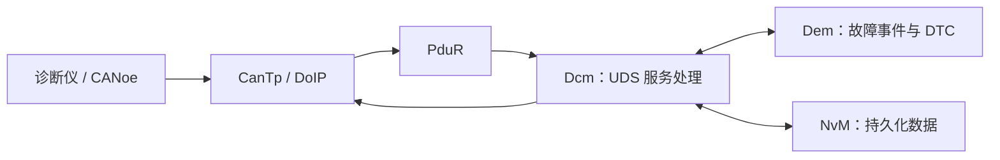
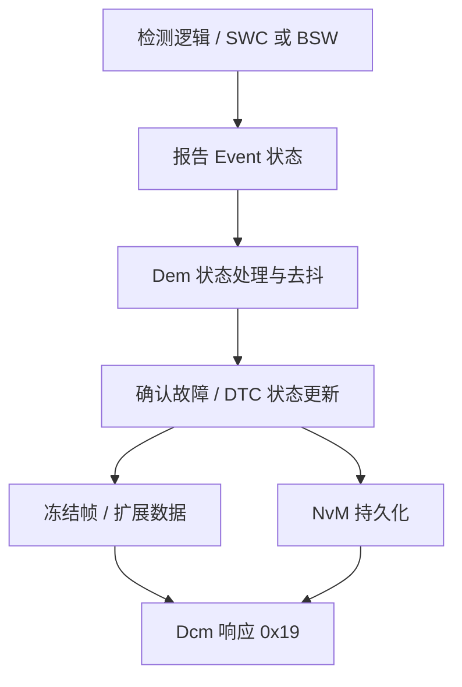

# 诊断栈 Dcm / Dem / UDS 工程实战

> 面向 Classic Platform 工程调试。具体服务支持、配置项、API 与超时行为以项目采用的 AUTOSAR Release、ISO 14229 版本及供应商实现为准。

## 1. 诊断数据流

- **Dcm**：接收诊断请求、检查会话与安全条件、分发服务、组织响应。
- **Dem**：管理事件状态、故障确认与 DTC 信息，提供诊断数据访问。
- **FiM**：根据故障/抑制条件控制功能是否允许执行。
- **CanTp / DoIP**：承载诊断消息的传输层，分别适用于 CAN 与 IP 通道。
- **PduR**：按配置路由 PDU，不负责解释 UDS 服务语义。

## 2. 常见 UDS 服务速查

| SID | 服务 | 工程关注点 |
|---|---|---|
| 0x10 | DiagnosticSessionControl | 会话切换、P2/P2*、会话权限 |
| 0x11 | ECUReset | 复位类型、复位执行时机 |
| 0x14 | ClearDiagnosticInformation | 清除组、权限与条件 |
| 0x19 | ReadDTCInformation | 子功能、DTC 状态掩码、记录格式 |
| 0x22 | ReadDataByIdentifier | DID 配置、长度、数据源与权限 |
| 0x27 | SecurityAccess | Seed/Key、尝试次数、延时策略 |
| 0x2E | WriteDataByIdentifier | 数据校验、权限、持久化与回读 |
| 0x2F | InputOutputControlByIdentifier | 控制权限、返回控制、恢复默认状态 |
| 0x31 | RoutineControl | Routine ID、启动/停止/结果查询 |
| 0x34/0x36/0x37 | 下载/传输/退出 | 长度、块序号、刷写状态机 |
| 0x3E | TesterPresent | 会话保持与 S3Server 计时 |
| 0x85 | ControlDTCSetting | DTC 设置控制及恢复策略 |

表格是常见服务概览，并不意味着每个 ECU 都必须支持所有 SID 或子功能。

## 3. NRC 为什么重要？

Negative Response Code（NRC）用于说明请求为何不能按预期执行。调试时应区分：
- 请求格式或长度错误；
- SID / Sub-function 不支持；
- 当前会话或安全级别不允许；
- 前置条件不满足；
- 参数范围或数据记录不合法；
- 服务仍在处理，需要等待后续响应；
- 请求超时或传输层失败。

不要只看 NRC 数字就下结论；应同时记录请求原始字节、当前会话、安全状态、Dcm 配置、应用回调返回值和时间戳。

## 4. P2、P2* 与 S3 不要混淆

- **P2Server**：ECU 收到请求后，在规定响应时间内给出响应的约束。
- **P2*Server**：在适用场景下发送 ResponsePending 后，后续响应的时间约束。
- **S3Server**：非默认会话下，因诊断活动中断而回到默认会话的相关计时。
- **CanTp N_* 参数**：传输层的分段、流控与超时约束，不等于 Dcm 的 UDS 响应时间。

具体参数名称、配置位置和计时语义要以项目所用版本为准。

## 5. Dem 事件到 DTC 的基本链路

事件、DTC、DTC 状态位和故障确认不是同一个概念。一个事件可能映射到 DTC；去抖、存储条件、老化和清除策略均由配置与标准机制决定。

## 6. 常见故障排查

### 诊断仪发请求，Dcm 没有命中服务处理

1. CANoe/诊断仪确认请求确实发出，CAN ID、寻址类型和长度正确。
2. 检查 CanIf 接收、CanTp 重组、PduR 路由与 Dcm Rx PDU 连接。
3. 对多帧请求检查 Flow Control、块大小、分离时间和序列号。
4. 检查 Dcm 配置是否包含对应 SID、子功能和会话权限。
5. 确认当前运行的生成配置与被检查的 ARXML 一致。

### 0x22 DID 返回不支持或条件不满足

1. 核对 DID 是否配置、长度和读回函数是否正确。
2. 核对会话、安全级别、模式规则与访问条件。
3. 检查应用数据源是否初始化，异步读取是否正确完成。
4. 核对响应长度、字节序和数据编码。
5. 使用同一请求做正向与反向测试，避免只验证“能读”而不验证边界条件。

### 0x19 查不到预期 DTC

检查事件是否被报告、去抖状态是否达到确认条件、DTC 映射与状态掩码是否正确、存储条件是否满足、DTC 是否被清除，以及请求的子功能/格式是否匹配。

### 0x27 SecurityAccess 失败

检查 seed/key 算法版本、字节序、长度、访问级别映射、尝试计数和延时锁定策略。不要在日志或提交记录中输出真实密钥或生产密钥材料。

## 7. 测试矩阵

- [ ] 支持/不支持的 SID 与子功能
- [ ] 默认会话、扩展会话及编程会话边界
- [ ] 未解锁、已解锁、错误 Key、重复错误 Key
- [ ] DID 正常值、边界值、长度异常与权限拒绝
- [ ] DTC 未确认、已确认、已清除、老化状态
- [ ] 单帧、多帧、错误序号、流控异常、超时
- [ ] ResponsePending 与最终响应时序
- [ ] 复位、掉电及重新上电后的诊断状态恢复

## 8. 官方资料

- AUTOSAR 标准入口：https://www.autosar.org/standards
- ISO 14229 UDS 的具体条款需依据项目可用的正式标准版本查阅。
