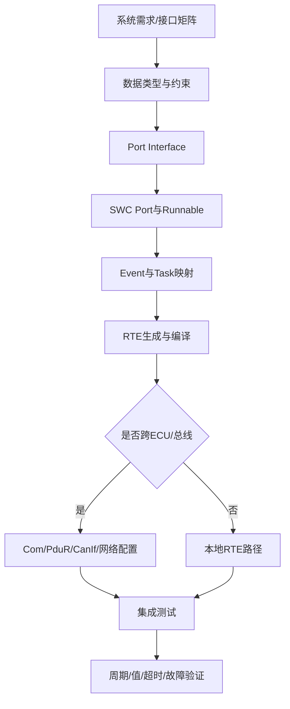
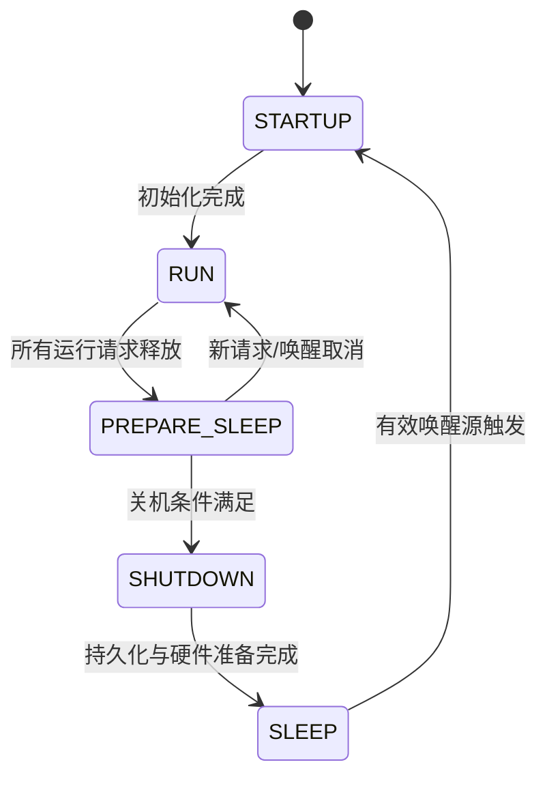
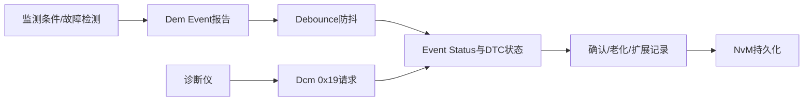
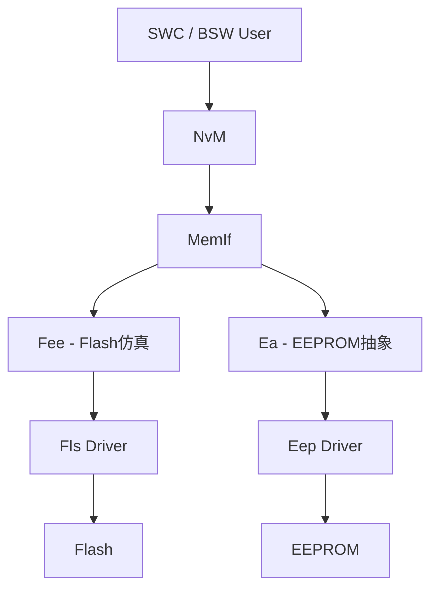

# CEM 工作问题清单

原始 Flomo：https://v.flomoapp.com/mine/?memo_id=MTc2MTEyODQ0

<u>CEM工作的100个问题</u>

1. 接口的配置操作？

2. 休眠唤醒的相关逻辑是什么？

#Area/技术/CEM
## CEM 软件工作问题：接口配置、休眠唤醒与基础软件链路

> CEM 在不同 OEM/项目中可能指不同的中央电子模块或功能域。以下以 AUTOSAR Classic ECU 的典型实现说明方法，不把供应商工具的界面步骤写成标准强制流程。最终应以项目 ARXML、接口矩阵、网络矩阵、软件需求和工具版本为准。

## Q1. CEM 中一个 SWC 接口从需求到可运行代码，配置操作怎么走？

**答案：** 接口配置不是只在工具里新建一个 Port。它要把需求信号、数据类型、接口定义、SWC Port、Runnable 访问、ECU 部署、RTE 生成和 BSW 通信映射串成闭环。

1. 从系统/网络/软件需求确认信号方向、周期、初始值、失效值、单位、范围、超时和安全等级。
2. 在数据类型层定义 ApplicationDataType、ImplementationDataType、单位/CompuMethod、DataConstr 等（具体模型按项目建模规范）。
3. 定义 Sender-Receiver 或 Client-Server Interface，明确 DataElement/Operation、队列语义、错误处理和传输属性。
4. 在 SWC 中配置 P-Port/R-Port，建立 Port Interface 引用。
5. 定义 Runnable、Event（Timing/ DataReceived/OperationInvoked 等适用事件）及其数据访问。
6. 配置 SWC 到 ECU 的部署、Runnable 到 OS Task 的映射及 RTE 事件触发。
7. 若信号跨 ECU 或走车载总线，继续配置 System/ECU Extract、ComSignal/ComIPdu、PduR、CanIf/CanTp 等对应链路。
8. 运行模型校验、代码生成和编译；对照生成的 Rte_Read/Rte_Write、RTE event、Com 配置和映射表核对。
9. 在台架上验证发送周期、接收值、初始值、超时、无效值、端序、缩放和错误路径。

**常见问题：** Port 引用错、DataElement 类型不一致、Runnable 未绑定事件、Task 映射遗漏、ComSignal 与 I-Signal/PDU 映射不一致、PduR 路由遗漏、端序/缩放不一致、接收超时策略不匹配。

## Q2. CEM 的休眠与唤醒逻辑是什么？

**答案：** 休眠不是“收到一个 Sleep 命令就关电”。它是 ECU 生命周期、网络管理、用户请求、持久化存储和硬件电源状态协同完成的状态转换。

**典型休眠路径：**
1. 应用功能进入允许关机的状态，释放通信/运行请求。
2. ComM/网络管理确认网络不再需要保持通信；其他通道也必须满足各自的关机条件。
3. BswM 根据模式请求和状态反馈执行配置动作，协调通信降级、关闭非必要功能等。
4. EcuM 检查关机条件、唤醒源配置和用户请求，进入 shutdown/sleep 流程。
5. NvM 完成必须持久化的数据写入，底层 Fee/Fls/Eep 操作结束或按项目定义处理超时。
6. OS/外设/收发器/电源管理芯片进入低功耗状态，保留唤醒检测路径。
7. MCU 进入目标低功耗模式。

**典型唤醒路径：**
1. CAN/LIN/以太网唤醒、硬件引脚、定时器或其他已配置唤醒源触发。
2. 收发器/PMIC 将唤醒事件传递给 MCU；芯片从低功耗状态恢复。
3. EcuM 验证唤醒源、推进启动状态并初始化必要模块。
4. BswM 根据启动/网络状态执行相应动作，ComM/CanSM 等恢复通信。
5. RTE/应用恢复 Runnable 与功能状态；诊断、网络和存储状态完成一致性检查。

**必须验证的边界：** 多网络同时活动、部分网络唤醒、诊断会话保持、NvM 写入超时、唤醒源误触发、快速睡醒、低电压复位、总线持续活动、唤醒原因记录和休眠电流。

## Q3. DTC 是怎样产生并保存的？DID 又是怎样读取的？

**答案：** DTC 是诊断故障信息，通常由 SWC/BSW 通过 Dem 事件接口报告事件状态，Dem 根据配置进行防抖、状态位更新、确认和存储；Dcm 负责处理诊断请求并访问 Dem 等服务。DID 是诊断数据标识符，Dcm 根据 DID 配置读取静态数据、RTE 数据、IO 控制或回调数据，具体数据源由项目定义。

**DTC 链路：**

需要检查 EventId 与 DTC 映射、DebounceCounter/Time 配置、OperationCycle、EnableCondition、存储条件、FreezeFrame/ExtendedData 和 NvM 块配置。

**DID 读取链路：** 诊断仪发送 UDS 0x22 + DID；Dcm 检查会话、安全等级、长度和访问权限；再根据 DID 数据源调用配置的读数据接口/回调，返回 0x62 + DID + DataRecord。负响应可能来自会话不支持、安全访问失败、DID 不存在、长度错误、条件不满足或应用数据读取失败。

## Q4. NvM 从应用层到 Flash 的数据保存链路是什么？

**答案：** 典型 AUTOSAR Classic 存储链路为 SWC/RTE 或 BSW 用户 → NvM → MemIf → Fee/Ea → Fls/Eep → Flash/EEPROM。NvM 管理逻辑块、RAM/ROM 默认值、校验、冗余/数据集和异步作业；Fee 在 Flash 上实现 EEPROM 仿真；Fls 驱动实际 Flash 读写擦除。若硬件是真 EEPROM，可能经 Ea/Eep 路径，具体由配置决定。

排查“写入成功但上电丢失”时，不能只看 NvM_WriteBlock 返回值；还要确认异步作业结果、NvM 状态、MainFunction 调度、Fee/Fls 作业状态、掉电预算、块 CRC、写入次数和恢复默认值策略。

## Q5. CEM 的通信协议栈如何排查？

**答案：** 先明确数据是应用信号、诊断请求还是网络管理报文。常见周期信号发送链路是 SWC → RTE → COM → PduR → CanIf → Can Driver → CAN Controller/Transceiver；接收方向相反。诊断物理寻址/功能寻址可能经过 CanTp → PduR → Dcm，不能将所有诊断报文当作普通 COM 信号。

排查按层推进：
- SWC/RTE：Runnable 是否触发，Rte_Write/Rte_Read 返回值和数据是否正确；
- COM：Signal/PDU 映射、更新位、发送模式、周期/超时、端序和缩放；
- PduR：路由源/目标、PDU ID 映射和方向；
- CanIf/Can：Controller、Hth/Hrh、Mailbox、波特率、过滤器和错误状态；
- Transceiver/总线：供电、Standby/Enable、终端、电平、接线、ACK、错误帧和 BusOff；
- 接收路径：超时监控、Invalidation、通知回调和应用消费周期。

## Q6. 如何把 CEM 的 100 个问题逐题变成可验收知识卡？

每题采用“问题 → 直接答案 → 原理 → 项目配置入口 → 生成代码/日志证据 → 台架验证 → 常见误区 → 相关模块”结构。涉及具体 ARXML 容器、DaVinci/EB 配置界面或 CEM 项目参数时，必须以实际项目文件为证，不凭空编造容器名或参数值。
