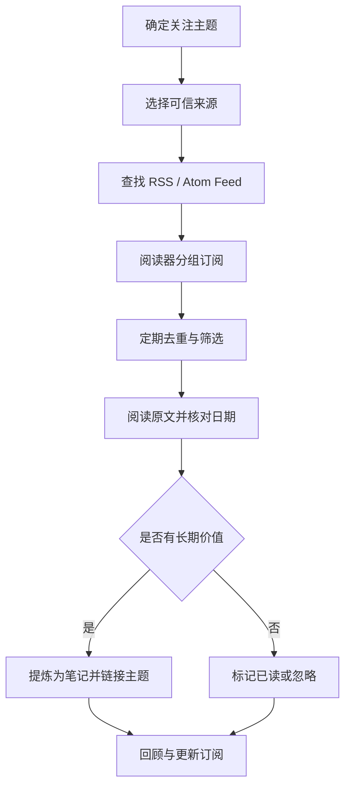

# RSS 与信息源管理

信息源管理的目标不是订阅越多越好，而是让可靠来源持续进入一个可筛选、可追溯、可复用的输入流程。RSS 适合自动收集更新，但仍需要人工判断来源质量和内容价值。

## 信息源分层

| 类型 | 主要用途 | 例子 |
|---|---|---|
| 官方标准与规范 | 确认定义、约束和版本 | AUTOSAR、ISO 标准发布机构、芯片厂商文档 |
| 专业媒体与技术社区 | 发现新技术和行业动态 | InfoQ、EEJournal、Hacker News、开源中国 |
| 论文与课程 | 系统学习和研究 | 大学课程、论文数据库、公开教材 |
| 开源项目 | 验证工程实现 | GitHub 仓库、Issue、Release 与示例代码 |
| 人文与通识资源 | 扩展背景知识 | 博物馆数字资源、数字敦煌、图书与讲座 |

## RSS 工作流

## 订阅源发现入口

- [V2EX RSS 讨论与分享](https://www.v2ex.com/t/878233)
- [公众号支持 RSS 订阅：实践文章](https://www.cnblogs.com/98record/p/gong-zhong-hao-zhi-chirss-ding-yue.html)
- [Feeds.pub Explore](https://feeds.pub/explore)
- [RSS Source：中文订阅源推荐](https://rss-source.com/)
- [AboutRSS / ALL-about-RSS](https://github.com/AboutRSS/ALL-about-RSS)
- [播客 RSS Feed 发现](https://getpodcast.xyz/)

## 订阅源质量与维护

1. **优先一手来源**：标准、产品变更、漏洞和版本信息优先回到官方公告或原始文档。
2. **记录来源属性**：主题、发布方、Feed URL、最近更新时间、语言和可信度。
3. **控制订阅数量**：先订阅高信噪比来源；大量订阅会制造信息负担。
4. **定期检查失效源**：Feed 404、长期不更新、重复转载或内容质量下降时，修复、替换或取消订阅。
5. **保留原文链接**：笔记记录结论时，同时保存原文 URL 和发布日期，避免只留下脱离上下文的摘要。
6. **谨慎处理个人配置**：公开知识库只记录公开来源和通用方法，不公开私有订阅地址、访问令牌、API Key、个人账号或内部工作群信息。

## 231 个精选 RSS 源的历史线索

Flomo 曾保存一份由 zhaoolee 于 2021 年整理的 231 个 RSS 源合集，覆盖科技博客、软件分享、团队技术博客、新闻资讯和产品运营等类别。它适合作为发现候选源的历史清单，不代表所有链接今天仍有效；导入前应逐条验证 Feed 是否可用、是否仍由原作者维护。

## 相关来源

- Flomo「RSS 资源发现入口」：https://v.flomoapp.com/mine/?memo_id=ODE1MTQzNTQ
- Flomo「RSS 订阅源合集（231 个精选）」：https://v.flomoapp.com/mine/?memo_id=MjQ4NDczMjEw
- Flomo「个人信息来源分类」：https://v.flomoapp.com/mine/?memo_id=MTMzNDk2NDI3
