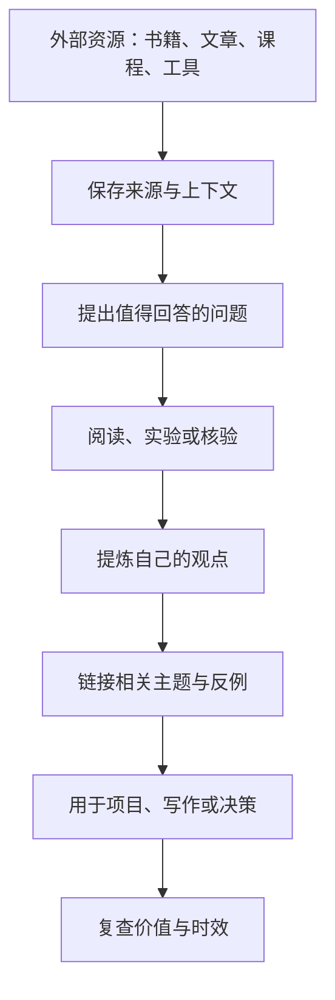

# Resource（资源）

资源区用于存放暂时没有明确项目归属、但未来可能帮助学习、研究或创作的主题与参考材料。资源不是无限期收藏夹：当一份材料开始服务于具体目标时，应将其关联到项目或领域。

## 资源导航

| 分类 | 内容 | 推荐用法 |
| --- | --- | --- |
| [[Education]] | 小学一年级学习资料 | 按学科与学习目标查找 |
| [[微信读书/index|微信读书]] | 自动同步的个人书架、划线数量与阅读记录入口 | 先检索书籍，再提炼自己的观点 |
| **GitHub** | 建站、Markdown 与知识发布参考文档 | 记录可复用的工具方法 |
| **Movie** | 影视相关资料 | 关联主题、人物与观后思考 |
| **RSS** | 订阅与内容索引配置 | 将持续输入转化为研究问题 |

## 资源进入知识库的路径

## 处理原则

- 保存来源、作者或发布方，以及收藏它的原因。
- 发现资料重复、过时或失效时，合并、更新或移除。
- 将真正理解的观点提炼为独立笔记，并链接到相关领域。
- 当资源开始服务于有明确交付目标的工作时，将其关联到对应项目。
- 自动生成的数据页应通过对应导入流程更新，不要手工修改生成内容。

## 相关入口

- [[Area/index|Area]] —— 长期维护的能力与责任
- [[Project/index|Project]] —— 有目标、有交付物的工作
- [[Archive/index|Archive]] —— 已结束或暂时不活跃的内容
- [[Area/KM/index|知识管理工作流]]
