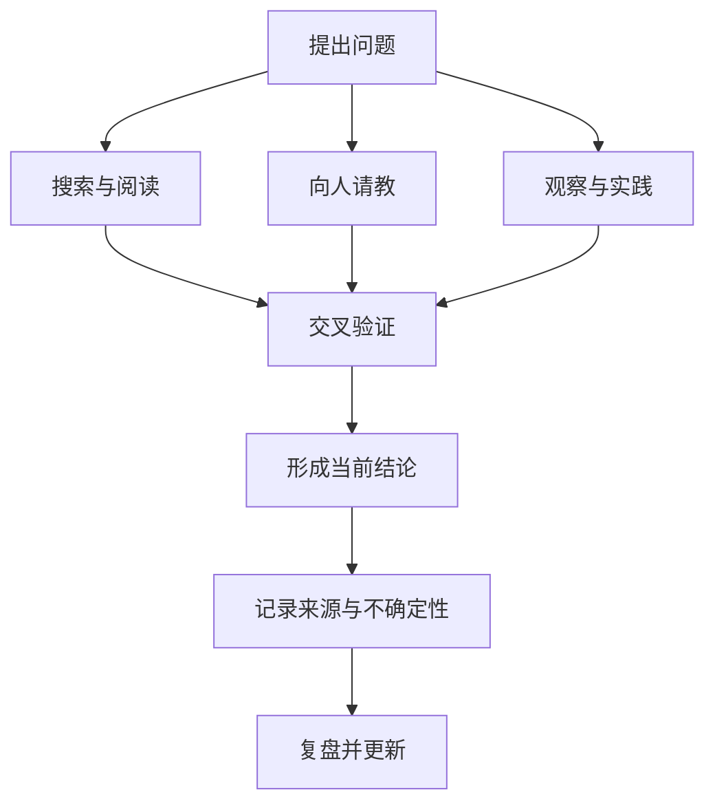

# 日常知识基础速查

本页将零散的日常知识卡片整理成可检索的参考入口。涉及法规、标准目录和车辆功能时，以官方现行文件、车辆说明书和当地规定为准；历史笔记只作为线索，不直接当作最新规则。

## 1. 信息获取的四种方式

| 方式 | 常见渠道 | 提升质量的方法 |
|---|---|---|
| 数字化搜索 | 搜索引擎、专业数据库、网站 | 使用精确关键词，优先核对一手来源与发布日期 |
| 人际交流 | 专家访谈、同行讨论、讲座 | 先做基础检索，提出具体开放问题，并记录可验证线索 |
| 观察与阅读 | 书籍、论文、标准、现场观察 | 围绕问题主题交叉阅读，比较不同来源的观点 |
| 实践与反思 | 实验、项目、复盘 | 记录条件、数据、失败现象和结论边界 |

**信息质量检查：** 谁发布的？何时发布？是否为原始资料？是否有数据和方法？其他独立来源能否交叉验证？结论适用的版本、地区和条件是什么？

## 2. RSS：把网站更新汇总到阅读器

RSS（常见解释包括 Really Simple Syndication、RDF Site Summary）是一类基于 XML 的内容订阅格式。网站发布 Feed，阅读器定期读取更新，用户无需逐个打开网站检查。

**典型流程**

- **Feed**：网站公开的订阅地址，通常是 XML。
- **阅读器**：定期抓取多个 Feed，并汇总标题、摘要、时间和链接。
- **RSS 与 Atom**：都是联合供稿格式，具体字段和版本不同；现代订阅系统应按实际 Feed 格式解析。
- **使用建议**：为高价值来源单独分组；对重要文章保存原始链接、发布时间和摘要；失效 Feed 定期检查。

## 3. 汽车灯光系统速查

### 车外灯光

| 类别 | 常见灯具 | 主要用途 |
|---|---|---|
| 照明 | 近光灯、远光灯、前雾灯、倒车灯 | 照亮道路、改善特定天气或倒车视野 |
| 信号与示廓 | 位置灯、示廓灯、转向灯、制动灯、高位制动灯 | 表明车辆位置、宽度、转向和减速意图 |
| 恶劣天气与驻车 | 后雾灯、驻车灯 | 提高低能见度条件下的辨识度，或在规定条件下提示停放车辆 |
| 新型交互 | 自适应前照灯、ADB、投影/迎宾灯 | 根据环境调整照明或提供提示；是否配备取决于车型与法规 |

### 车内灯光

- **基础照明**：前后排顶灯、阅读灯、手套箱灯、行李厢灯。
- **功能照明**：仪表和中控背光、门槛/迎宾照明、化妆镜灯。
- **交互与显示**：氛围灯、HUD 显示光学系统等。

**工程观察点：** 灯光功能通常涉及开关输入、车身控制器/域控制器、通信信号、诊断、供电保护和输出驱动。分析具体 ECU 时，应以车辆 E/E 架构、网络矩阵、诊断需求和硬件原理图为准。

> 灯光使用场景和法规要求因国家/地区而异；不要把旧笔记中的照射距离或“智能灯标配”等描述视为所有车型的通用规格。具体操作以车辆用户手册和当地交通法规为准。

## 4. 参考分类与目录

### 《中国图书馆分类法》

《中国图书馆分类法》用于图书馆文献分类。一级大类以字母表示，覆盖马克思主义与哲学、社会科学、政治法律、军事、经济、文化教育、语言文学、历史地理、自然科学、工业技术、农业、交通、航空航天、环境安全和综合性图书等领域。

- 官方参考入口：[国家图书馆《中国图书馆分类法》专题](http://clc.nlc.cn/ztfdsb.jsp)
- 使用时以当前发布版本及具体馆藏编目规则为准；旧笔记中的分类细目可能已调整。

### 研究生教育学科专业目录

Flomo 原笔记记录的是 2022 年发布的《研究生教育学科专业目录》相关内容，介绍学科门类、一级学科和专业学位类别的代码结构。它是历史版本资料，不应直接用于当前招生判断。

- 原始政策来源：[中国政府网政策文件（2022）](https://www.gov.cn/zhengce/zhengceku/2022-09/14/content_5709785.htm)
- 实际报考、招生和学位授予应查询教育主管部门及招生单位发布的最新目录和当年招生简章。

## 5. 常用面积单位换算

- 1 平方英尺（ft²）= 144 平方英寸（in²）
- 1 平方英尺 = 0.09290304 平方米（m²）
- 1 平方英尺 ≈ 929.0304 平方厘米（cm²）
- 1 平方英尺 = 1/9 平方码（yd²）

换算时先确认使用的是长度单位还是面积单位；面积换算需要对长度换算系数平方。

## Flomo 来源

- 信息获取方式： https://v.flomoapp.com/mine/?memo_id=MTMzNDk2MzM3
- 车内外灯光系统： https://v.flomoapp.com/mine/?memo_id=ODY2ODE3NDQ
- RSS 基础说明： https://v.flomoapp.com/mine/?memo_id=ODE1MzIyNTQ
- 中国图书馆分类法： https://v.flomoapp.com/mine/?memo_id=ODEwMTE4OTA
- 研究生教育学科专业目录（2022）： https://v.flomoapp.com/mine/?memo_id=ODMyNTEwNDQ
- 面积单位换算： https://v.flomoapp.com/mine/?memo_id=ODA1MzMxMDI
