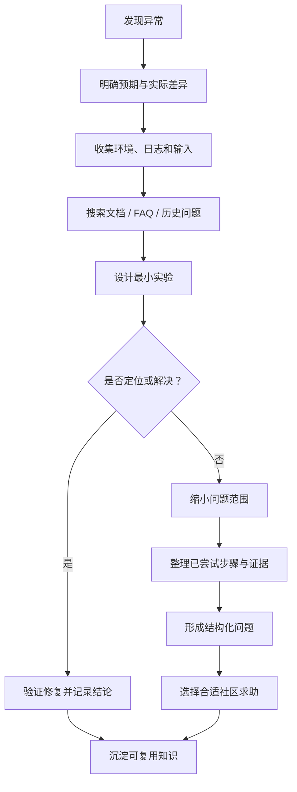
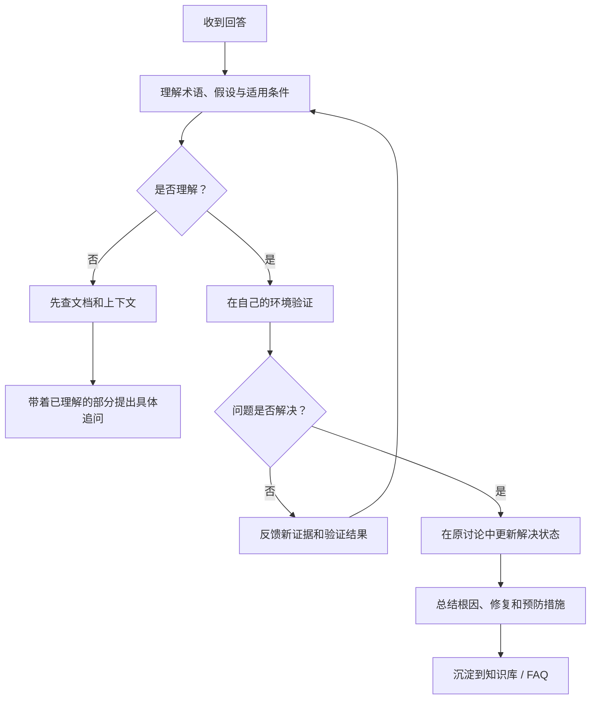
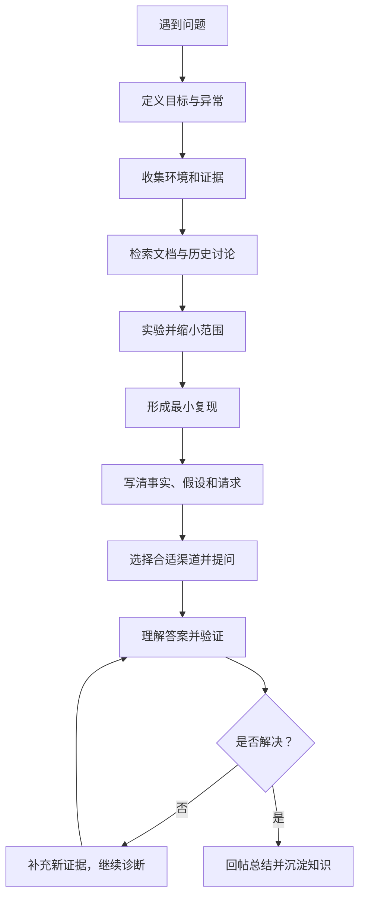

# 提问的智慧：如何提出一个值得回答、容易解决的问题

> **核心观点：高质量提问不是把问题包装得漂亮，而是先完成必要的观察、检索和实验，再把事实、目标、证据与具体请求组织成别人能够接手的问题。**

本文基于 Eric S. Raymond 与 Rick Moen 的指南 *How To Ask Questions The Smart Way* 中文版本进行学习整理与独立分析。以下是对原文思想的提炼、补充和工程化改写，不是原文全文转载。

- 原文：[@ryanhanwu/How-To-Ask-Questions-The-Smart-Way](https://github.com/ryanhanwu/How-To-Ask-Questions-The-Smart-Way)
- 中文版： [README-zh_CN.md](https://github.com/ryanhanwu/How-To-Ask-Questions-The-Smart-Way/blob/main/README-zh_CN.md)
- 英文原文： [How To Ask Questions The Smart Way](http://www.catb.org/~esr/faqs/smart-questions.html)
- 作者：Eric S. Raymond、Rick Moen
- 笔记定位：技术沟通方法、问题诊断方法、协作规范

## 1. 一页理解：好问题的本质

一个好问题应当让接收者快速理解四件事：

1. **目标是什么**：你最终想实现什么，而不是只描述你尝试过的某个操作。
2. **现象是什么**：实际发生了什么，预期又是什么，两者差异在哪里。
3. **证据是什么**：环境、日志、最小复现、已尝试步骤和结果。
4. **希望对方做什么**：解释原理、指出排查方向、审查方案，还是帮助定位某个具体环节。

可以把它概括为：

`好问题 = 明确目标 + 可观察事实 + 有效证据 + 清晰请求`

问题描述越具体，回答者越不需要通过多轮追问来补齐上下文。

## 2. 提问前：先完成自己的排查

原文强调，在求助前先查阅已有讨论、搜索网络、阅读手册和 FAQ、进行实验；如果涉及程序开发，还应尝试阅读相关源码。

这并不意味着必须独自解决问题，而是要把“我遇到了问题”推进为“我已经把问题缩小到这里”。

### 推荐的预检清单

- [ ] 搜索完整错误信息，而不只是搜索“程序出错”。
- [ ] 检查官方文档、FAQ、版本说明和已知问题。
- [ ] 搜索项目 Issues、Discussions、论坛和历史讨论。
- [ ] 确认软件版本、运行环境、依赖版本和配置。
- [ ] 尝试最小化复现，区分必现与偶发。
- [ ] 每次只改变一个关键变量，并记录结果。
- [ ] 将已尝试的方法、观察到的结果和仍未知的部分分开记录。

### 排查过程图



**关键提醒：** 搜索不是走形式。搜索过哪些关键词、查过哪些文档、哪些方法无效，本身就是有价值的诊断信息。

## 3. 提问时：把信息组织成可诊断结构

### 3.1 选择正确的提问渠道

不同问题应进入不同的讨论空间：

| 问题类型 | 优先渠道 |
| --- | --- |
| 工具使用、常见配置 | 官方文档、用户论坛、社区问答 |
| 编程语言与通用开发 | 对应语言社区、Stack Overflow |
| 特定开源项目行为 | 项目 Issues / Discussions |
| 服务器、网络和运维 | 对应运维社区、项目支持渠道 |
| 安全漏洞或敏感信息 | 项目安全响应渠道，不公开泄露细节 |

发帖前先阅读社区规则，确认问题属于该社区范围。不要把同一个问题无差别地复制到大量渠道；必要时说明已经在哪些地方求助，并保持信息同步。

### 3.2 标题要描述问题，而不是表达情绪

| 不推荐 | 更有效 |
| --- | --- |
| 救命！程序不能用了 | Vercel 容器启动后未监听分配端口，部署健康检查失败 |
| 求大神帮忙看看 | AUTOSAR RTE 生成后 Rte_Read 返回初始值，特定 Runnable 中可复现 |
| 急！编译报错 | GCC 13.2 在 ARM 目标下因某头文件类型冲突导致编译失败 |

标题最好包含：**对象 + 现象 + 关键条件**。

### 3.3 区分事实、推测和目标

不要把推测写成事实。

- 事实：启动日志显示进程退出码 127。
- 推测：可能是容器启动命令格式不正确。
- 目标：确认实际执行命令，并让服务监听平台分配的端口。

这种区分能避免讨论过早陷入错误方向。

### 3.4 描述症状，不要先替别人下结论

例如，不要只写“数据库有 Bug”。应说明：

- 执行了什么操作；
- 输入数据是什么；
- 预期结果是什么；
- 实际结果是什么；
- 是否稳定复现；
- 从哪个版本开始出现。

**可观察的症状是证据，原因判断是待验证假设。**

### 3.5 提供最小可复现案例

最小复现（Minimal Reproducible Example，MRE）应尽可能只保留触发问题所需的代码、配置、输入和步骤。

一个好的最小案例通常具备：

- 独立：别人不必获得你的整个项目。
- 可运行：说明依赖、版本和执行方式。
- 可验证：明确预期与实际输出。
- 足够小：去掉与问题无关的业务逻辑和敏感数据。

不要上传数百行代码然后只说“不能运行”。先尝试缩减到几十行甚至更小。

## 4. 技术问题标准模板

下面的模板适用于 GitHub Issue、技术论坛、团队群组和代码评审中的求助。

```markdown
## 标题
[组件/模块] 在 [环境/条件] 下出现 [具体异常]

## 1. 目标
我希望实现什么？

## 2. 环境
- 操作系统：
- 软件/工具版本：
- 运行环境：
- 关键依赖：
- 配置差异：

## 3. 预期结果
我认为正常情况下应该发生什么？

## 4. 实际结果
实际发生了什么？错误信息和日志是什么？

## 5. 复现步骤
1.
2.
3.

## 6. 最小复现
提供最小代码、配置、输入或示例工程。

## 7. 已尝试的排查
| 尝试 | 结果 | 得到的结论 |
| --- | --- | --- |
| 检查官方文档 | ... | ... |
| 更换配置 | ... | ... |
| 最小化复现 | ... | ... |

## 8. 当前判断
哪些是已确认事实？哪些只是推测？

## 9. 希望获得的帮助
希望对方解释原理、指出排查方向，还是审查某个方案？
```

并非每个问题都需要填满所有栏目。简单问题保持简洁；复杂问题则尽量提供完整证据。**模板的目的是减少遗漏，不是制造表单负担。**

## 5. 如何让问题更容易得到有效回答

### 5.1 降低回答成本

专家通常不是缺少知识，而是缺少时间。提问者应主动完成上下文整理：

- 把关键日志放在问题正文，而不是让别人猜测附件内容。
- 标出最相关的错误行和发生时间。
- 对长日志进行裁剪，但保留错误前后的上下文。
- 对代码使用代码块，并注明语言。
- 提供可访问的最小示例，避免要求对方先搭建完整环境。
- 明确希望得到的帮助范围。

### 5.2 让别人能参与诊断

比起“直接把解决方案给我”，更有效的请求可能是：

- “从这段调用链看，下一步最值得检查哪个边界条件？”
- “这个日志能否证明请求没有进入应用层？”
- “我把复现缩小到这个函数，是否还缺少关键变量？”
- “这个配置与官方文档的差异是否会影响端口绑定？”

这类问题邀请对方贡献判断，而不是把整个问题外包给别人。

### 5.3 礼貌、耐心、尊重边界

- 感谢别人投入的时间。
- 不因没有立即得到回复就重复刷屏。
- 不要求陌生人私下提供免费的一对一支持。
- 对批评先判断技术内容，再决定是否回应语气。
- 对真正有帮助的回答，补充结果并感谢贡献者。

礼貌不能替代技术信息，但能让协作更顺畅。

## 6. 如何阅读和跟进答案

收到答案后，不应只复制命令或代码。应先理解其适用条件，再验证是否解决了自己的问题。

### 答案处理闭环



### RTFM 与 STFW 的正确理解

RTFM（阅读手册）和 STFW（先搜索网络）有时是直接的提醒：答案可能已经存在于文档或历史讨论中。

更有价值的做法不是争论语气，而是确认：

1. 对方指向了哪份文档或哪个关键词？
2. 文档中哪些内容与当前问题相关？
3. 自己是否理解了这些内容？
4. 仍然缺少哪个具体环节？

如果文档看过但仍不理解，应指出读到的章节、自己的理解和具体疑点，而不是只问“这是什么意思”。

## 7. 问题解决后：把一次问答变成公共知识

问题解决并不意味着协作结束。建议在原讨论中补充：

- 最终根因；
- 真正有效的修复步骤；
- 哪些尝试无效以及原因；
- 适用的软件版本和环境；
- 是否需要更新文档、FAQ 或测试用例。

这样后来遇到同样问题的人可以直接检索到答案，维护者也能发现文档和产品中的薄弱点。


## 8. 深度分析：这份指南真正有价值的地方

### 8.1 它把提问看作一种问题建模能力

提问不是简单描述困惑，而是把模糊现象转化为可验证的问题。这个过程包含：

- 抽象：从大量细节中识别关键变量。
- 分解：把复杂问题拆成可独立验证的子问题。
- 证据化：用日志、实验和数据代替直觉。
- 边界化：明确当前结论适用于什么条件。
- 协作化：把问题整理成别人可以参与的任务。

因此，提问能力本质上与系统思维、调试能力和工程表达能力高度相关。

### 8.2 好问题是一种压缩后的诊断报告

一个高质量问题并不是越长越好，而是用尽可能少的文字，保留足以判断问题的关键信息。

可以用一个实用标准衡量：

> 读者能否在不进行第一轮追问的情况下，复现问题或提出有针对性的下一步检查？

如果不能，通常说明环境、现象、证据或请求还不完整。

### 8.3 从“索取答案”转向“共同求解”

低质量提问把责任完全交给别人；高质量提问则把自己已经完成的工作展示出来，并邀请他人补足认知盲区。

这并不意味着新手必须先成为专家才有资格提问。新手完全可以提出好问题，只要诚实说明自己知道什么、不知道什么、试过什么。

### 8.4 从个人效率扩展到组织知识复利

当问题、答案、验证结果和修复过程被保留在公开 Issue、团队知识库或 FAQ 中，单次沟通就能帮助未来的其他人。

对工程团队而言，这能减少重复排查，缩短新人熟悉系统的时间，并让隐性经验逐步变成可维护的组织资产。

### 8.5 原文的局限与现代使用时的修正

这份指南诞生于早期开源社区文化，部分措辞带有强烈的圈层色彩。今天阅读时应保留方法论，避免照搬其可能显得傲慢或排斥新手的表达。

- **不要把“先做功课”变成求助门槛。** 初学者可以提问；关键是尽可能诚实地描述自己的理解和困难。
- **不要把技术直接等同于人的价值。** 问题质量可以评价，不能据此给提问者贴人格标签。
- **不要把礼貌与清晰对立起来。** 直接表达事实，也可以尊重他人。
- **不要泄露敏感信息来换取可复现性。** 日志、配置和代码应脱敏，密钥、令牌、客户数据和个人信息不能公开。
- **不要把最小复现当成唯一证据。** 并发、时序、硬件、网络和生产环境问题可能无法完全缩小，应提供可观察证据和受控复现步骤。
- **不要迷信搜索结果。** 文档可能过时，答案可能不适用于当前版本；必须核对版本、日期和官方来源。

## 9. 工程场景示例：把模糊求助改写成可执行问题

### 示例 A：Vercel 部署失败

**模糊表达：**

“我的网站部署失败了，帮我看看。”

**结构化表达：**

“Quartz 站点在 Vercel 容器部署后健康检查失败。目标是让服务监听平台分配的端口。当前 Dockerfile 的启动命令为……；部署日志显示……；本地使用相同镜像可以……；我已经验证……。请帮助确认是启动命令、监听端口还是运行时类型配置导致的问题。”

### 示例 B：AUTOSAR 通信异常

**模糊表达：**

“CAN 通信不正常，是不是 COM 有问题？”

**结构化表达：**

“某 CAN 接收信号在 ECU 上未更新。预期周期为 10 ms，实测应用层值持续保持初始值。当前已确认总线报文存在，CANoe 中信号值正常；尚未确认 CanIf、PduR、Com 到 RTE 的数据路径。环境为……，相关 PDU/Signal 配置为……。希望协助判断下一步应检查哪个接收链路边界，并确认是否存在 I-PDU 路由或信号映射问题。”

### 示例 C：C 语言异常

**模糊表达：**

“这个指针为什么不对？”

**结构化表达：**

“在函数返回后读取结构体成员时出现异常。编译器版本为……，目标平台为……。最小代码如下……；预期输出……，实际输出……。使用调试器观察到地址……，变量生命周期为……。我怀疑是对象生命周期或越界访问，但尚未确认。请帮忙检查代码中是否存在未定义行为。”

## 10. 提问质量自检表

| 维度 | 自检问题 |
| --- | --- |
| 目标 | 是否说明真正想达成的结果？ |
| 环境 | 是否给出关键版本、平台和依赖？ |
| 现象 | 是否区分预期与实际？ |
| 证据 | 是否提供日志、输入、代码或实验结果？ |
| 排查 | 是否记录已尝试的方法及结果？ |
| 假设 | 是否把推测明确标为推测？ |
| 范围 | 是否提出一个可回答的具体请求？ |
| 安全 | 是否移除了密钥、令牌和敏感数据？ |
| 跟进 | 是否准备在解决后补充结论？ |

## 11. 可复用的提问流程



## 12. 进一步思考

1. 一个问题需要提供多少上下文，才能让回答者不必反复追问？
2. 如何判断某条日志是根因证据，还是仅仅与故障同时发生？
3. 哪些问题适合公开社区，哪些问题必须进入内部或安全渠道？
4. 如何把团队中重复出现的问题转化为自动化检查、测试或文档？
5. AI 可以帮助整理问题，但如何避免它把猜测包装成事实？

## 结论

**提问的质量，取决于问题被理解和验证的难度，而不取决于措辞有多复杂。**

真正值得练习的是：先观察，再检索；先验证，再推断；先说明目标和事实，再提出具体请求；问题解决后，再把经验沉淀为他人可以复用的知识。

这套方法不仅适用于技术论坛，也适用于代码评审、团队协作、故障复盘、向 AI 提问和日常学习。

## 相关笔记

- [[Area/KM/知识管理|知识管理]]
- [[Area/KM/知识管理工作流|知识管理工作流]]
- [[Area/KM/渐进阅读|渐进阅读]]
- [[Area/KM/微信读书到永久笔记|微信读书到永久笔记]]
- [[Resource/index|资源总览]]
- [[关系图谱|知识关系图谱]]

## 来源与版权说明

本笔记为学习整理与评论，引用原文观点时以概述为主。原指南版权与翻译信息请以原项目说明为准：

- [原指南中文版本及版权说明](https://github.com/ryanhanwu/How-To-Ask-Questions-The-Smart-Way/blob/main/README-zh_CN.md)
- [Eric S. Raymond 原文](http://www.catb.org/~esr/faqs/smart-questions.html)
