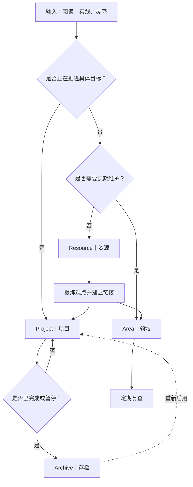

# 🪴 数字花园

这里不是资料的堆放处，而是一个持续生长的知识系统：把输入转化为理解，把理解转化为可复用的笔记，再把笔记连接成自己的知识网络。

> **使用原则：先解决当前问题，再沉淀可复用知识；先写清楚一个观点，再追求笔记数量。**

## 从哪里开始

| 入口 | 用途 | 适合什么时候打开 |
| --- | --- | --- |
| [[Project/index|项目 Projects]] | 推进有目标、有交付物和完成条件的工作 | 正在做一个具体项目 |
| [[Area/index|领域 Areas]] | 维护长期能力、职责和标准 | 持续学习或维护某项能力 |
| [[Resource/index|资源 Resources]] | 收集暂时没有明确项目归属的主题、资料与灵感 | 阅读、研究、发现新问题 |
| [[Archive/index|存档 Archives]] | 保存已完成或暂时不活跃、但仍有价值的内容 | 项目结束、主题暂时搁置 |

## 🧭 PARA：让笔记有去处

PARA 管理的是**行动与责任的归属**，不是知识本身的全部结构。一篇笔记可以通过双向链接连接多个主题，但最好只有一个清晰的主要归属。

## 🧠 知识沉淀工作流

1. **捕获**：先记录问题、原文出处或灵感，避免打断当前任务。
2. **澄清**：用自己的话回答“它在说什么？为什么重要？什么情况下不成立？”
3. **拆分**：一张卡片聚焦一个主要观点，避免把摘录、结论和行动混在一起。
4. **连接**：链接到相关概念、相反观点、案例和正在推进的项目。
5. **应用**：将知识用于代码、决策、写作、复盘或解决实际问题。
6. **复查**：删除重复内容，补充证据，更新已经过时的结论。

更详细的工作流见 [[Area/KM/知识管理工作流]]。

## 🗂️ 主要领域

- [[Area/index|领域总览]]：长期维护的能力与责任。
- [[Resource/index|资源总览]]：值得探索的主题、工具和参考资料。
- [[Project/index|项目总览]]：正在推进的目标与交付物。
- [[Archive/index|存档总览]]：已完成或暂时搁置的内容。

## ✍️ 一张好笔记的检查清单

- [ ] 标题表达一个明确的问题或观点，而不是只有一个宽泛名词。
- [ ] 内容使用自己的语言，能脱离原文独立理解。
- [ ] 关键事实、引用和数据保留来源。
- [ ] 至少建立一个有意义的关联，或说明暂时没有关联的原因。
- [ ] 写清适用条件、反例或尚未解决的问题。
- [ ] 如果它能指导行动，补充下一步实践。

## 🌱 关于这个花园

数字花园允许内容逐步完善。草稿可以不完整，观点也可以被修正；重要的是标明不确定性、保留来源，并让新知识能够与旧知识发生联系。

相关主题：[[Area/KM/数字花园]] · [[Area/KM/Git提交规范]]
