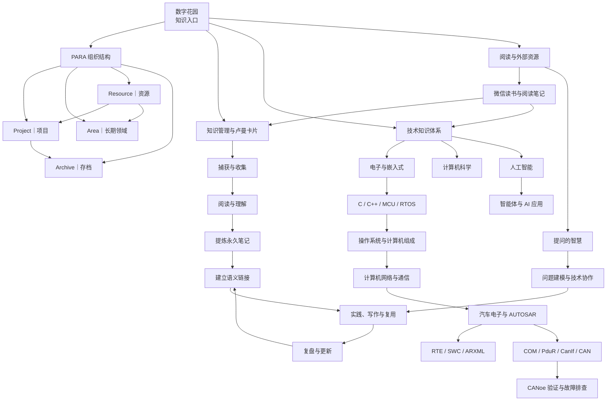
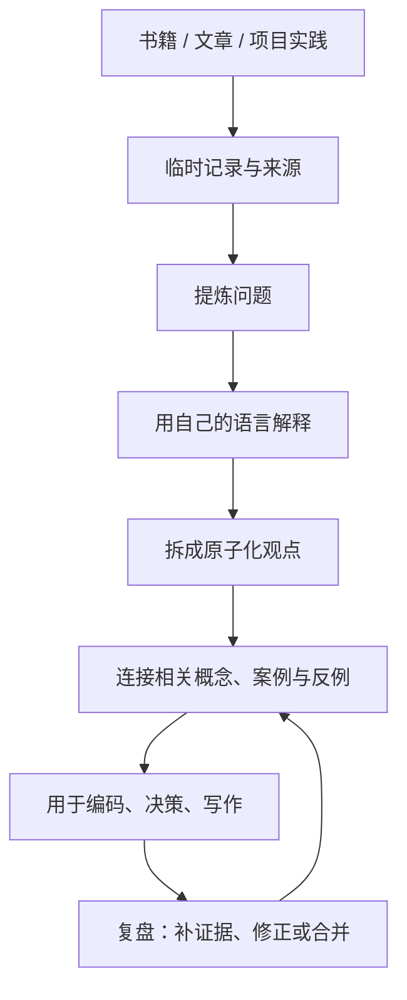
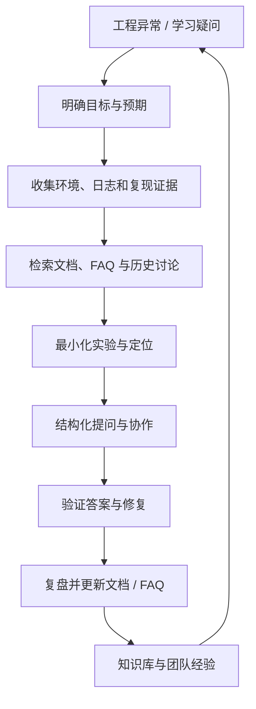

# 知识关系图谱

这里把笔记之间的**主题关系、学习依赖和实践路径**放在同一张地图里。图谱不是目录的替代品：目录负责定位，关系图谱负责理解“哪些知识互相支撑、可以沿什么路径继续学习”。

> [!tip] 如何使用
> - 从下方的主题节点进入对应索引页，再沿着页面中的双向链接深入。
> - 在任意笔记右侧查看局部关系图；在全局图中展开全部可索引笔记的关系网络。
> - 新增笔记时，尽量链接到已有概念、上游基础、工程案例或相反观点，不要只添加标签。

## 1. 全局知识结构

## 2. 主题入口与关键连接

- **[[index|数字花园入口]]**：PARA 的总入口；连接 [[Area/index|长期领域]]、[[Project/index|项目]]、[[Resource/index|资源]] 与 [[Archive/index|存档]]。
- **[[Area/KM/index|知识管理]]**：连接 [[Area/KM/知识管理|知识管理原则]]、[[Area/KM/知识管理工作流|日常工作流]]、[[Area/KM/渐进阅读|渐进阅读]]、[[Area/KM/微信读书到永久笔记|微信读书到永久笔记]] 和 [[Area/KM/数字花园|数字花园发布]]。
- **[[Area/EE/EE|电子与嵌入式]]**：以 [[Area/EE/电子基础|电子基础]]、[[Area/EE/C语言|C 语言]]、[[Area/EE/MCU|MCU]]、[[Area/EE/RTOS|RTOS]]、[[Area/EE/操作系统|操作系统]]、[[Area/EE/计算机网络|计算机网络]] 为基础，向汽车电子工程实践延伸。
- **[[Project/AUTOSAR/index|AUTOSAR 项目]]**：连接 [[Project/AUTOSAR/核心理念|核心理念]]、[[Project/AUTOSAR/软件架构|软件架构]]、[[Project/AUTOSAR/方法论|方法论]]、[[Project/AUTOSAR/标准与规范|标准与规范]]、[[Project/AUTOSAR/规范模块/index|规范模块]] 和工程实践专题。
- **[[Resource/index|阅读资源]]**：包括 [[Resource/微信读书/index|微信读书]]、[[Resource/Education/index|教育资料]]、[[Resource/沟通与协作/提问的智慧|提问的智慧]]、GitHub、RSS 与影视资料。外部摘录应继续加工成自己的观点，并链接到对应领域或项目。

## 3. 工程知识链：从基础到 AUTOSAR 实战

推荐沿着 [[Area/EE/EE|嵌入式知识总览]] → [[Project/AUTOSAR/index|AUTOSAR 总览]] → [[Project/AUTOSAR/RTE与SWC工程实现|RTE 与 SWC 工程实现]] → [[Project/AUTOSAR/ARXML与RTE代码生成实战|ARXML 与 RTE 代码生成实战]] → [[Project/AUTOSAR/通信栈工程实战与CANoe验证|通信栈与 CANoe 验证]] → [[Project/AUTOSAR/AUTOSAR故障排查手册|故障排查手册]] 的路径学习。

## 4. 知识管理链：从输入到可复用知识

详细方法见 [[Area/KM/知识管理工作流|知识管理工作流]] 与 [[Area/KM/微信读书到永久笔记|微信读书到永久笔记]]。

## 5. 提问与工程协作链

[[Resource/沟通与协作/提问的智慧|提问的智慧]] 将知识管理延伸到问题诊断与团队协作：先把异常转化为可验证的问题，再通过证据和实验缩小范围，最后将解决方案沉淀为可检索知识。

推荐将 [[Resource/沟通与协作/提问的智慧|提问的智慧]] 与 [[Area/KM/知识管理工作流|知识管理工作流]] 配合使用：前者解决“如何把问题说清楚”，后者解决“如何把答案变成可复用知识”。

## 6. 当前图谱盘点与维护规则

基于仓库当前生成的 Quartz 内容索引，页面数与链接关系会随笔记更新、链接解析和标签变化而变化；应以最新构建索引为准，不将历史统计视为固定值。

- **主要枢纽**：[[Area/index|Area 总览]]、[[Project/AUTOSAR/规范模块/index|AUTOSAR 规范模块索引]]、[[Project/AUTOSAR/规范模块/CP|Classic Platform]]、[[Project/AUTOSAR/AUTOSAR|AUTOSAR 总览]]、[[Project/AUTOSAR/规范模块/RTE|RTE]]。
- **需要优先补强的连接**：资源书目到永久笔记、计算机基础到汽车电子、AUTOSAR 规范到工程实践、AI/智能体到具体项目案例。
- **孤立页面检查**：构建索引中有少量页面没有解析到其他页面的链接。新增或整理笔记时，应优先补充至少一个有语义的关联；若确实独立，写明原因。
- **避免无意义连边**：不要为了增加连线而堆砌链接。链接最好能表达“前置知识”“组成部分”“实践案例”“相反观点”“应用场景”或“来源”中的一种关系。
- **标签不是关系的全部**：标签适合聚类，双向链接表达具体语义，索引页负责学习顺序，三者应互相补充。

## 相关入口

- [[index|数字花园首页]]
- [[Area/index|领域总览]]
- [[Project/index|项目总览]]
- [[Resource/index|资源总览]]
- [[Area/KM/index|知识管理]]
